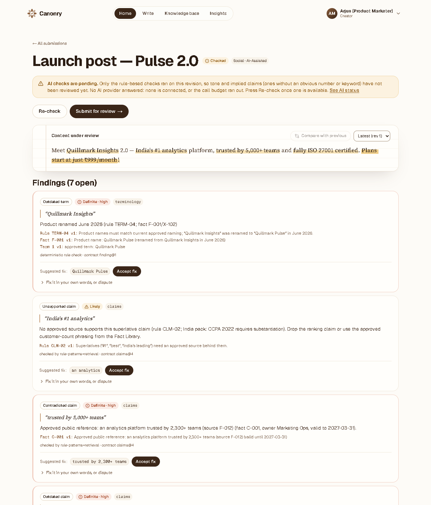
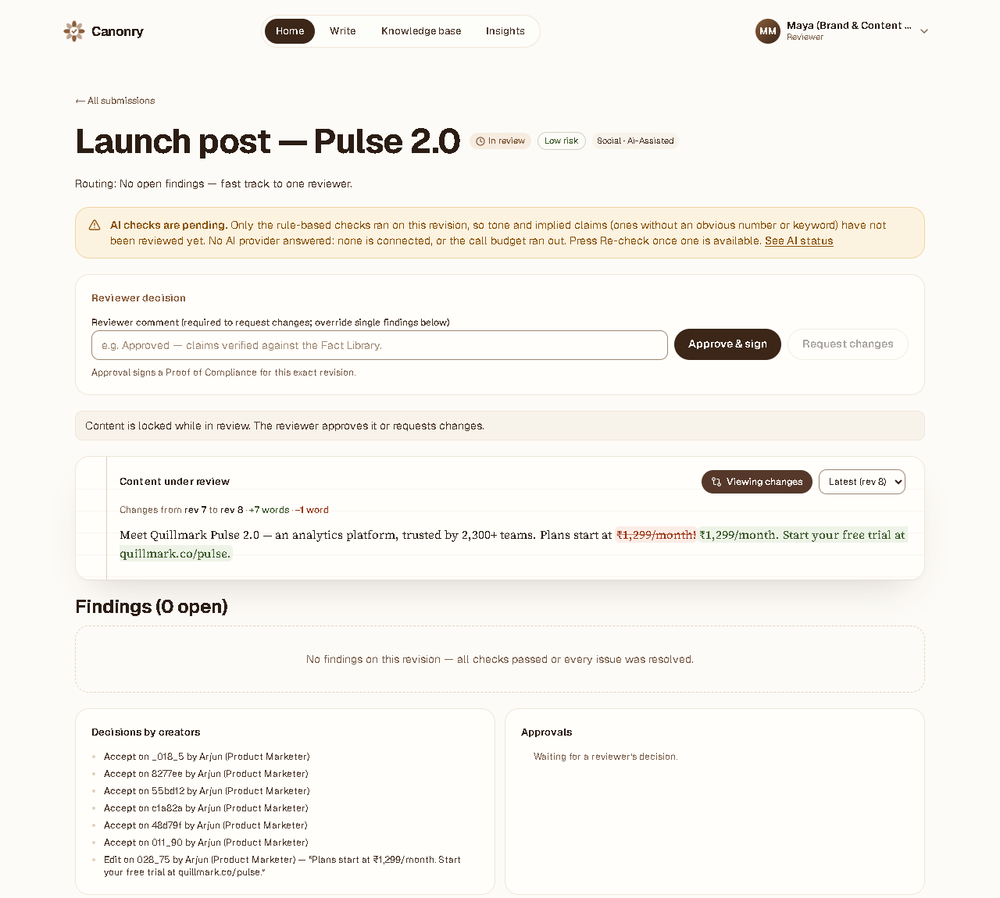
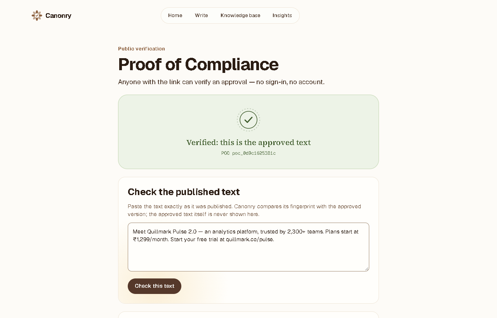
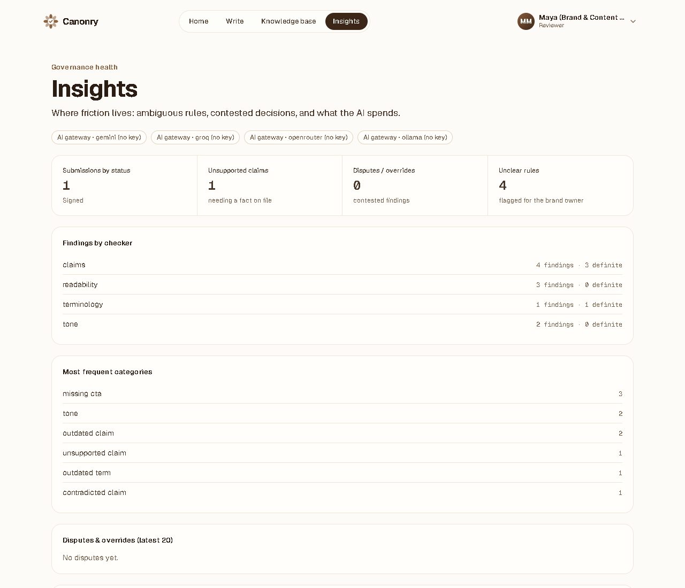
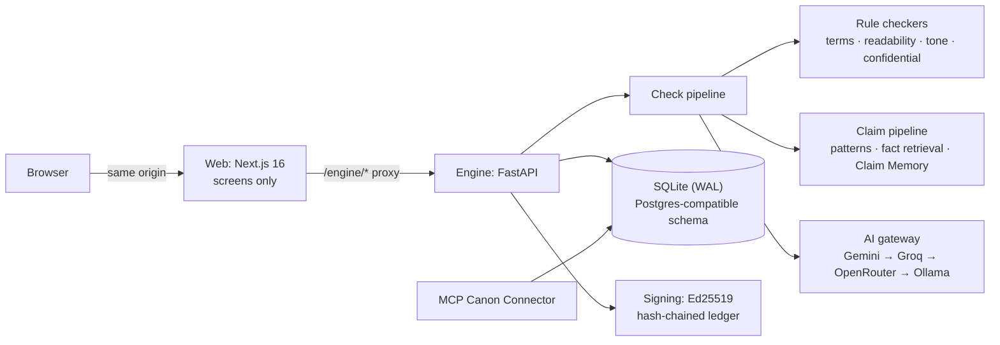

# Canonry — brand governance before publication

> **Inkloom AI Brand Governance Challenge · Round 2 (The Build) · Team vaidvansh6**
> Vansh Vaid (team leader) · Dhruv Puri

Canonry checks marketing content **before it is published** against the
organisation's own approved rules, facts and terminology. Every issue comes back
**explained, cited and with a minimal fix**; a **person** decides; and the
approval is sealed so anyone can later check that the published text is the
approved one.

Principle from our Round 1 plan, kept in the build: **rules before AI**.
Deterministic checks are free, fast and certain; an AI model handles only what
rule patterns cannot (implied claims, tone), and the product works with no AI
key at all.

| | |
|---|---|
| **Live demo** | **<https://canonry-sigma.vercel.app>** — choose a role, *Continue as guest* (engine: <https://canonry-engine.onrender.com/health>; free tier, the first visit after idle can take ~50 s). Deploy your own: [docs/deployment.md](docs/deployment.md) |
| **Run locally** | [Quick start](#4-quick-start) (about 5 minutes, no accounts, no keys) |
| **Source** | <https://github.com/Dhruv-Puri/Canonry> |
| **Round 1 plan** | `Canonry_Round1_Plan_vaidvansh6.pdf` (submitted in Round 1) |

---

## 1. The core workflow (runs end to end)

```mermaid
flowchart LR
    A["Creator pastes copy<br/>(channel + source)"] --> B["Check run<br/>rules → claims → AI"]
    B --> C["Findings: span · why ·<br/>citation · tier · fix"]
    C --> D["Creator accepts / edits / disputes<br/>→ new revision, re-checked"]
    D --> E["Submit: risk router<br/>low · medium · high · exempt"]
    E --> F["Reviewer approves, requests changes<br/>or overrides with a reason"]
    F --> G["Signed Proof of Compliance<br/>(Ed25519, hash-chained)"]
    G --> H["Public /verify page:<br/>paste text → Verified / Modified"]
```



1. A **creator** submits copy and picks a channel (social, web, blog, email, sales) and a source (in-house, agency, AI-assisted).
2. The engine returns **findings**. Each has the exact text span, a plain explanation, a **citation** to the real rule or fact behind it, a **confidence tier** (Definite / Likely / Consider) and, where possible, a one-click minimal fix.
3. The creator **accepts**, **edits** or **disputes** (with a reason) each finding. Every change creates a new revision that is re-checked automatically; a word-level diff shows what changed.
4. **Submit for review**: a router assigns risk and the reviewer level. A narrow, logged exemption lane can auto-approve clean email digests.
5. A **reviewer** approves, requests changes, or overrides a single finding with a reason. High-severity findings block approval until resolved or explicitly overridden: the AI never decides.
6. Approval signs a **Proof of Compliance**: SHA-256 of the approved text, approver role, knowledge version and time, signed with Ed25519. Approved content is then locked.
7. Anyone can open `/verify/<id>` without signing in and paste the published text: **Verified** (exact approved text) or **Modified**.

### What it looks like

The seeded launch post, from first check to public proof (production build, demo mode, no AI key):

| 1 · The creator sees cited findings | 2 · After fixing, the reviewer decides |
|---|---|
|  |  |
| **3 · Anyone verifies the published text** | **4 · Insights for the brand owner** |
|  |  |

Fixing the seven findings turned *"Meet Quillmark Insights 2.0 — India's #1 analytics
platform, trusted by 5,000+ teams and fully ISO 27001 certified. Plans start at just
₹999/month!"* into *"Meet Quillmark Pulse 2.0 — an analytics platform, trusted by 2,300+
teams. Plans start at ₹1,299/month. Start your free trial at quillmark.co/pulse."*:
every number now traces to an approved fact, and the router fast-tracked it as low risk.

## 2. Round 2 requirements → where to find them

| Brief requirement (Round 2) | Where |
|---|---|
| Functional product / MVP | this repository: engine + web app; demo workspace seeded on first boot |
| Judge-accessible source repository | <https://github.com/Dhruv-Puri/Canonry> |
| Deployed link or clear demonstration | live link above; [docs/deployment.md](docs/deployment.md); [docs/tutorial.md](docs/tutorial.md) guided tour |
| Architecture and main technical decisions | [§5](#5-architecture) · [docs/architecture.md](docs/architecture.md) · [docs/decision-log.md](docs/decision-log.md) (D1–D53, dated) · [changes from the Round 1 plan](docs/plan-vs-build.md) |
| APIs, AI models, datasets, libraries, templates, external services | [§6](#6-what-we-used-apis-models-data-libraries) · [docs/disclosure-log.md](docs/disclosure-log.md) |
| Evidence of user testing or structured feedback | [§8](#8-user-testing) · [docs/usability-test-kit.md](docs/usability-test-kit.md) |
| Each team member's contribution | [§9](#9-team-and-contributions) |

| Judging criterion (points) | Evidence |
|---|---|
| Core workflow runs end to end (30) | §1 journey; `test_engine.py` drives it through the API; seeded launch post to try it in the browser |
| Technical depth and reliability (25) | 11 test suites + evaluation gate in CI (§7); finding contract enforced on every finding; role scoping and lifecycle locks tested; honest AI degradation |
| Progress against the plan (20) | [docs/plan-vs-build.md](docs/plan-vs-build.md): every plan commitment, what changed and why; [docs/changelog.md](docs/changelog.md): milestones M1–M6 with evidence |
| The three improvements (15) | §3 |
| Usability so far (10) | password-free demo personas, plain-language findings, one-click fixes; usability kit (§8) |

## 3. The three improvements we committed to

| Improvement (Round 1 plan) | In this build | Measured |
|---|---|---|
| **1. Claim checking against approved sources** | Explicit claims (counts, prices, percentages, certifications, superlatives, dates) found by patterns and labelled supported / contradicted / outdated / unsupported against the Fact Library; numbers compared by value; implied claims via one batched AI call. **Verified Claim Memory** reuses a verdict only for identical numbers and the same knowledge version | frozen evaluation split: claims recall 100%, precision 100% (targets ≥ 85% / ≥ 80%); see the limits in §10 |
| **2. Guideline-clarity insights** | Vague-rule linting at import (no examples, contradictory, duplicate); disputes and overrides feed an Insights page; "possibly unclear rules"; fact-expiry alerts listing affected approved content; **rule tests & change preview** shows which approved content a rule edit would newly break | Insights page on live data; `test_knowledge.py`, `test_edge_cases.py` |
| **3. Confidence tiers and verified citations** | Every finding carries a tier and at least one citation; the citation check discards any finding whose rule or fact does not exist or is inactive ("no citation, no finding"); every finding is validated against the versioned contract `finding@1`; citations pin the rule/fact version they were checked against | invalid citations shown: **0**; "Definite" precision 100% (target ≥ 95%) |

### Changes from the Round 1 plan

Every Must and Should item of the plan is delivered. The main changes, all
explained in [docs/plan-vs-build.md](docs/plan-vs-build.md):

- **SQLite instead of Supabase Postgres + pgvector**: zero setup for judges; the schema keeps Postgres names, and role rules live in one module instead of row-level security.
- **Exact keyword and number matching instead of embeddings** for facts: "2,300+" must never match "3,200+".
- **Demo personas plus password and invitation sign-in** instead of Google sign-in: judges need no account; production use stays secure.
- **Text content this round**: DOCX/PDF content upload, image checks and file metadata stamps move to Round 3; the public verify page checks pasted text instead.
- **AI call ledger instead of Sentry/Langfuse**; fixed provider fallback instead of a confidence-based model cascade.
- **Added during the build**: rule bindings (any rulebook works), a lifecycle lock for approved content, publishable-facts-only claim checks, local Ollama fallback.

## 4. Quick start

Needs Python 3.11+ and Node.js 20+. Run from this folder.

```bash
# 1. Engine (FastAPI, port 8000) — demo mode seeds the Quillmark workspace
python -m venv .venv
.venv/Scripts/pip install -r engine/requirements.txt        # macOS / Linux: .venv/bin/pip
# start the engine: demo mode, port 8000, auto-reload (no shell variables needed)
.venv/Scripts/python engine/run_local.py        # Windows: PowerShell or Git Bash
.venv\Scripts\python engine\run_local.py        # Windows: Command Prompt
.venv/bin/python engine/run_local.py            # macOS / Linux

# 2. Web (Next.js 16, port 3000), in a second terminal
cd web
npm install
npm run dev
```

Open <http://localhost:3000>, pick a role and press **Continue as guest**. No
account, email or password is needed:

| Role | What you can do |
|---|---|
| Creator | write drafts and fix what Canonry flags |
| Reviewer | approve drafts or send them back |
| Agency partner | submit work for a client brand (sees only its own work) |
| Brand admin | manage the brand's rules and facts |

As a Creator, open **Launch post — Pulse 2.0**, fix and submit it; then switch to
Reviewer from your name in the top bar, and approve and sign it. AI checks show as *pending* until you add a free key (copy
`.env.example` to `.env`); everything else works without one. Details and
troubleshooting: [docs/getting-started.md](docs/getting-started.md).

## 5. Architecture



| Engine module (`engine/`) | Responsibility |
|---|---|
| `main.py` | HTTP API: sign-in, knowledge base, submissions, review, verify, insights |
| `pipeline.py` | one check run: rule checks → claims → AI → contract and citation check → store |
| `checkers.py` | deterministic checks (terminology, readability, CTA, tone heuristics, confidential leaks) |
| `claims.py` | claim detection, fact retrieval, verdicts, Verified Claim Memory |
| `policy.py` | which workspace rule each built-in check enforces (rule bindings) |
| `workflow.py` | what each submission status allows (draft → review → signed) |
| `access.py` | what each role may see (agency scoping, confidential redaction) |
| `gateway.py` | AI provider adapters, fallback chain, call budget, call ledger |
| `quota.py` | daily AI allowance per person and per workspace |
| `contract.py` | the versioned finding contract `finding@1` |
| `signing.py` | Proof of Compliance: sign and verify |
| `knowledge.py` | versioned rules, facts and terms, with history and change impact |
| `mcp_server.py` | Canon Connector: approved facts for AI writing tools over MCP |
| `db.py`, `seed.py` | schema, migrations, demo workspace from `data/*.csv` |

Main technical decisions (full list with reasons in the [decision log](docs/decision-log.md)):

- **One FastAPI engine + Next.js web behind a same-origin proxy** (D35): every rule lives in the engine; the web app only renders. No CORS, cookies stay first-party.
- **SQLite now, Postgres-compatible schema** (D35): zero-setup for judges; table and column names already match the managed Postgres + pgvector target.
- **Rules before AI, honest degradation** (D37): deterministic checks always run; with no AI provider the run is marked `ai_pending`, never silently skipped.
- **Rule bindings** (D43): checks cite the workspace's own rules, so the engine works with any rulebook, not just the demo's.
- **Free models only** (D28, D48): Gemini, Groq and OpenRouter free tiers plus local Ollama, ≤ 3 answered calls per 1,000 words; confidential facts are never sent.
- **Daily AI allowance** (D53): free keys run out without warning, so each person gets 5 AI-assisted checks a day and the workspace 50 (both configurable). Out of tries, rule-based checks still run and the screen says why AI was skipped and when it resets.
- **Signed approvals** (D24, D46): Ed25519 seals that third parties can check against the published text.

## 6. What we used (APIs, models, data, libraries)

| Kind | What | Notes |
|---|---|---|
| AI models (optional, runtime) | Gemini `gemini-2.5-flash`, Groq `llama-3.1-8b-instant`, OpenRouter `llama-3.3-70b-instruct:free`, Ollama `llama3.1:8b` | free tiers or local; each model overridable by environment variable; not configured in the default demo |
| Dataset | fictional Quillmark Analytics brand book: 43 rules, 41 facts (some expiring, superseded or confidential), 10 terms (`data/*.csv`); 20-sample labelled evaluation set (`engine/evaluation/eval_set.jsonl`) | invented for the challenge; no real company data |
| Engine libraries | FastAPI, uvicorn, httpx, pydantic, PyNaCl | `engine/requirements.txt` |
| Web libraries | Next.js 16, React 19, Tailwind CSS 4, Radix UI primitives, lucide-react, class-variance-authority | `web/package.json`; shadcn/ui component recipes |
| Protocol | Model Context Protocol (JSON-RPC 2.0 over stdio) | Canon Connector |
| Services | GitHub Actions (CI), Render (engine), Vercel (web) | all free tiers |
| AI assistance in development | Anthropic Claude (Claude Code), Codebuff | disclosed in [docs/disclosure-log.md](docs/disclosure-log.md) |

## 7. Tests and reliability

```bash
.venv/Scripts/python engine/tests/run_tests.py     # 11 suites (fresh DB each) + evaluation gate
```

| Suite (`engine/tests/`) | Proves |
|---|---|
| `test_engine` | the full journey: submit → findings → fix → review → sign → verify |
| `test_identity` | roles, sessions, names in the trail, labelled self-approval |
| `test_knowledge` | versioned knowledge-base writes, history, change impact, write races |
| `test_regressions` | every bug found in review stays fixed; MCP connector over stdio |
| `test_seed_data` | the demo CSVs load completely |
| `test_edge_cases` | input validation, payload shapes, number formats, seal tampering |
| `test_policy` | checks cite the workspace's own rules; retiring a rule switches its check off |
| `test_access` | agency partners see only their own work; confidential text never leaks |
| `test_workflow` | content locked in review and after signing; public verification of pasted text |
| `test_gateway` | AI fallback chain, honest call ledger, no confidential data sent (faked providers, no network) |
| `test_quota` | daily AI allowance: 5 per person, 50 per workspace, clear reasons when out of tries, failed provider calls never charged |
| evaluation gate | precision / recall per checker and tier on the frozen split; fails on regression |

The suites never call a real AI provider, even when your `.env` holds keys: they read no
`.env` and fake the providers where AI behaviour is tested.

CI ([`.github/workflows/ci.yml`](.github/workflows/ci.yml)) runs all of it on every push, plus
a web type-check, a production build, `pip-audit` and `npm audit`.
Bugs found by testing, and how each was fixed: [docs/progress.md](docs/progress.md) §7–8.

## 8. User testing

A moderated usability test with 5 participants and the SUS questionnaire is
prepared in [docs/usability-test-kit.md](docs/usability-test-kit.md) (tasks,
script, results sheet). **Results will be recorded there and summarised here
once the sessions are run**; no results are claimed yet.

## 9. Team and contributions

| Member | Role | Contribution |
|---|---|---|
| **Vansh Vaid** (team leader) | Product, web app, workflow, documentation | Round 1 plan; web screens and review workflow; Round 2 hardening, versioned knowledge base and identity (commit `9a90cee`); documentation |
| **Dhruv Puri** | Analysis engine, retrieval, AI gateway, evaluation | initial engine and project setup (commit `699e7d7`); claim pipeline, gateway and evaluation ownership |
| Shared | | infrastructure, security, testing, demo |

Commit history on GitHub shows who changed what and when.

## 10. Known limitations

- **AI checks depend on free tiers**: the live demo runs Gemini with Groq as fallback, capped per person per day; when every provider is busy, implied claims and tone are marked *pending* and the rule-based findings still show. CI tests the AI path with faked providers only.
- **Small evaluation set**: 20 hand-built samples (6 frozen), labelled by the team, over the demo brand. It measures the deterministic engine exactly; independent double-labelling and a larger set are Round 3 work.
- **Text only**: images, DOCX/PDF review and accessibility checks are planned for Round 3 (plan Section 11).
- **Demo identity**: demo mode lets anyone act as any role. Production mode (passwords, one-use invitations, no self-approval) exists but is not the judge deployment.
- **Free hosting is ephemeral**: on Render free, data and seals reset on restart ([docs/deployment.md](docs/deployment.md) §6).
- **Retrieval is keyword-based**: pgvector retrieval on managed Postgres is the Round 3 upgrade (schema already compatible).

## 11. Repository layout

```
.
├── README.md                ← you are here
├── .env.example             ← optional AI keys (copy to .env; never committed)
├── render.yaml              ← free Render blueprint for the engine (judge demo)
├── .github/workflows/ci.yml ← tests, evaluation gate, web build, dependency audits
├── data/                    ← demo brand book: rules, facts, terms (CSV)
├── engine/                  ← FastAPI analysis engine (all product logic)
│   ├── *.py                 ← modules listed in §5
│   ├── tests/               ← 11 suites + run_tests.py
│   ├── evaluation/          ← evaluate.py, labelled set, committed baseline
│   ├── Dockerfile
│   └── requirements.txt
├── web/                     ← Next.js 16 app (screens only)
│   └── src/app/             ← /, /new, /submissions/[id], /kb, /insights, /verify/[pocId]
└── docs/                    ← see below
```

| Document | Read it for |
|---|---|
| [tutorial](docs/tutorial.md) | a guided 15-minute tour for first-time users |
| [getting-started](docs/getting-started.md) | install, run and test in 10 minutes |
| [deployment](docs/deployment.md) | free deployment (Render + Vercel), demo vs production |
| [architecture](docs/architecture.md) | diagrams, data model, pipeline in detail |
| [design](docs/design.md) | product rules, finding contract, tiers, personas |
| [plan-vs-build](docs/plan-vs-build.md) | **what changed from the Round 1 plan, and why** |
| [approach](docs/approach.md) | how we built it, and the problems we hit |
| [changelog](docs/changelog.md) | progress against the plan, milestone by milestone |
| [progress](docs/progress.md) | status, bugs found and fixed, honest gaps |
| [decision-log](docs/decision-log.md) | every decision D1–D53, dated, with reasons |
| [disclosure-log](docs/disclosure-log.md) | AI tools, models, libraries and services used |
| [usability-test-kit](docs/usability-test-kit.md) | how we run and record user tests |
| [dev-notes/](docs/dev-notes/) | working specs and plans written during the build |

All code was written by team vaidvansh6 during the build window, with the AI
assistance disclosed above. Demo brand data is fictional.
