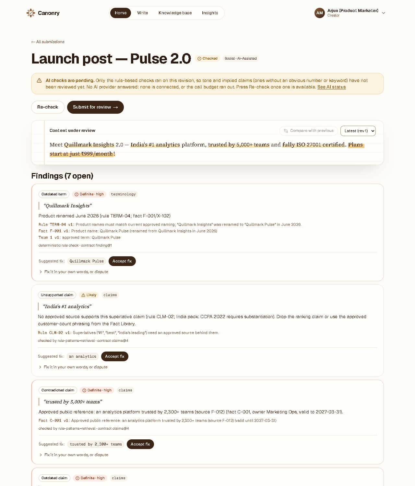
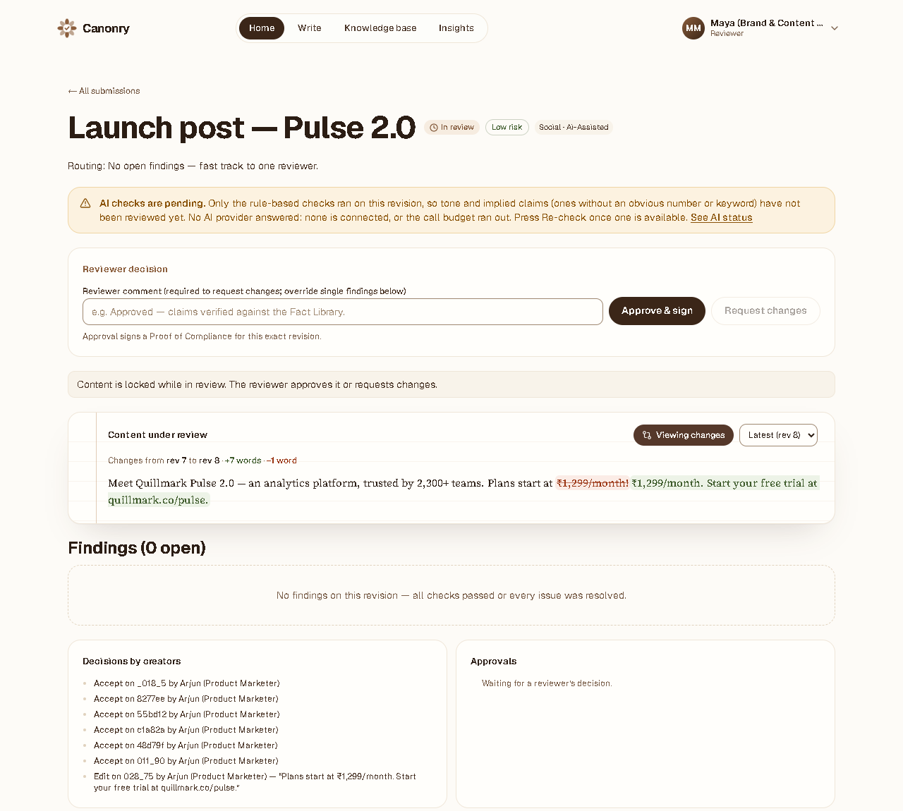
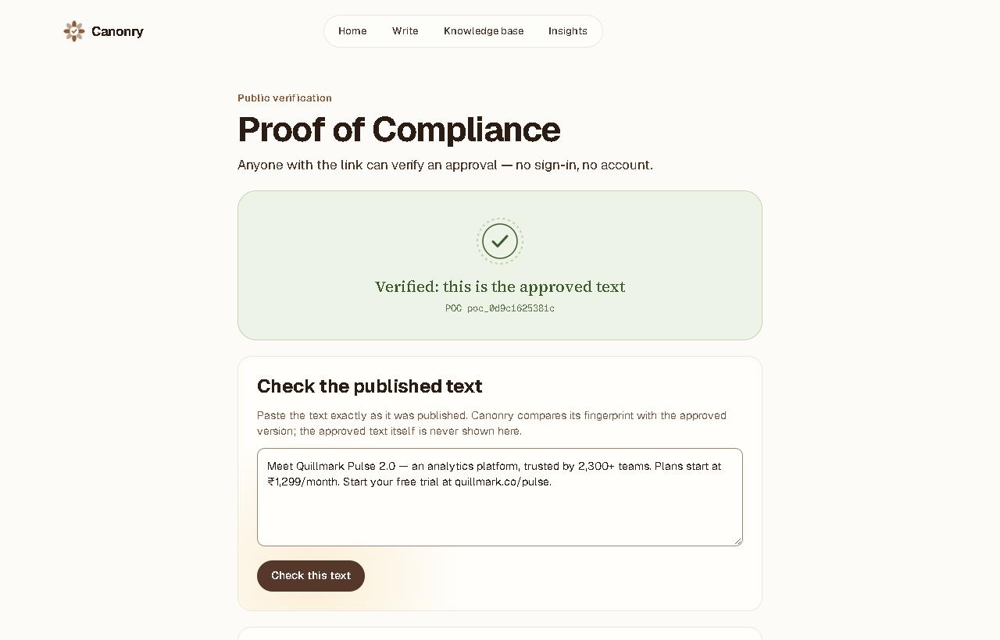
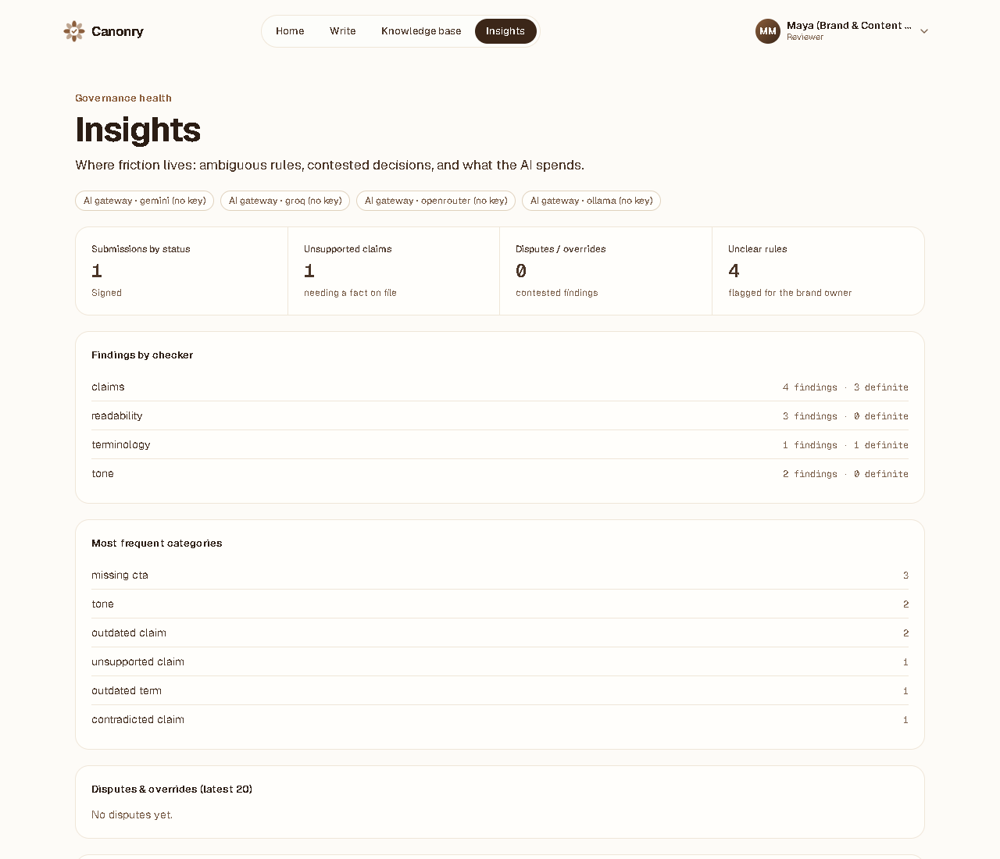
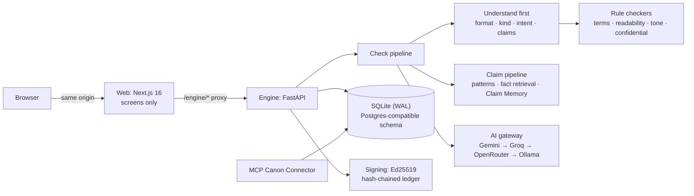

# Canonry — brand governance before publication

> **Inkloom AI Brand Governance Challenge · Round 2 (The Build) · Team vaidvansh6**
> Vansh Vaid (team leader) · Dhruv Puri

Canonry checks marketing content **before it is published** against the
organisation's own approved rules, facts and terminology. Every issue comes back
**explained, cited and with a minimal fix**; a **person** decides; and the
approval is sealed so anyone can later check that the published text is the
approved one.

Principle from our Round 1 plan, kept in the build: **rules before AI**.
Deterministic checks are free, fast and certain; an AI model handles only what
rule patterns cannot (implied claims, tone), and the product works with no AI
key at all.

| | |
|---|---|
| **Live demo** | **<https://canonry-sigma.vercel.app>** — choose a role, *Continue as guest* (engine: <https://canonry-engine.onrender.com/health>; free tier, the first visit after idle can take ~50 s). Deploy your own: [docs/deployment.md](docs/deployment.md) |
| **Run locally** | [Quick start](#4-quick-start) (about 5 minutes, no accounts, no keys) |
| **Source** | <https://github.com/Dhruv-Puri/Canonry> |
| **Round 2 PDF** | [docs/Canonry_Round2_Build_vaidvansh6.pdf](docs/Canonry_Round2_Build_vaidvansh6.pdf): links, completed features, technology, changes from the plan, Round 3 improvements (Part A), then the Round 1 plan as submitted (Part B) |

---

## 1. The core workflow (runs end to end)

```mermaid
flowchart LR
    A["Creator pastes copy<br/>(channel + source)"] --> B["Check run<br/>rules → claims → AI"]
    B --> C["Findings: span · why ·<br/>citation · tier · fix"]
    C --> D["Creator accepts / edits / disputes<br/>→ new revision, re-checked"]
    D --> E["Submit: risk router<br/>low · medium · high · exempt"]
    E --> F["Reviewer approves, requests changes<br/>or overrides with a reason"]
    F --> G["Signed Proof of Compliance<br/>(Ed25519, hash-chained)"]
    G --> H["Public /verify page:<br/>paste text → Verified / Modified"]
```



1. A **creator** submits copy and picks a channel (social, web, blog, email, sales) and a source (in-house, agency, AI-assisted).
2. The engine first **reads what the content is** (format, kind, purpose, audience, the claims it makes) and runs only the checks that fit it, then returns **findings**. Each has the exact text span, a plain explanation, a **citation** to the real rule or fact behind it, a **confidence tier** (Definite / Likely / Consider, shown as *Must fix* / *Should fix* / *Worth a look*) and, where possible, a one-click minimal fix. The page says what Canonry understood and which checks ran, and why.
3. The creator **accepts**, **edits** or **disputes** (with a reason) each finding. Every change creates a new revision that is re-checked automatically; a word-level diff shows what changed.
4. **Submit for review**: a router assigns risk and the reviewer level. A narrow, logged exemption lane can auto-approve clean email digests.
5. A **reviewer** approves, requests changes, or overrides a single finding with a reason. High-severity findings block approval until resolved or explicitly overridden: the AI never decides.
6. Approval signs a **Proof of Compliance**: SHA-256 of the approved text, approver role, knowledge version and time, signed with Ed25519. Approved content is then locked.
7. Anyone can open `/verify/<id>` without signing in and paste the published text: **Verified** (exact approved text) or **Modified**.

**First visit: an interactive walkthrough.** The welcome screen offers *Show me around (first time
here)*, ticked on a browser's first visit and unticked afterwards. When it is on, a small guide floats
beside the page, says the one next thing to do in plain words and puts a glowing ring on the exact
button: pick the sample → *Check draft* → *Accept all suggested fixes* → *Send for review* → switch to
*Reviewer* in the top-right menu → open the draft you sent → *Approve & sign* → *Verify*. It follows
what the visitor actually does, can be closed at any time, and never appears for returning visitors.

### What it looks like

The seeded launch post, from first check to public proof (production build, demo mode, no AI key):

| 1 · The creator sees cited findings | 2 · After fixing, the reviewer decides |
|---|---|
|  |  |
| **3 · Anyone verifies the published text** | **4 · Insights for the brand owner** |
|  |  |

Fixing the seven findings turned *"Meet Quillmark Insights 2.0 — India's #1 analytics
platform, trusted by 5,000+ teams and fully ISO 27001 certified. Plans start at just
₹999/month!"* into *"Meet Quillmark Pulse 2.0 — an analytics platform, trusted by 2,300+
teams. Plans start at ₹1,299/month. Start your free trial at quillmark.co/pulse."*:
every number now traces to an approved fact, and the router fast-tracked it as low risk.

## 2. Round 2 requirements → where to find them

| Brief requirement (Round 2) | Where |
|---|---|
| Functional product / MVP | this repository: engine + web app; demo workspace seeded on first boot |
| Judge-accessible source repository | <https://github.com/Dhruv-Puri/Canonry> |
| Deployed link or clear demonstration | live link above; [docs/deployment.md](docs/deployment.md); [docs/tutorial.md](docs/tutorial.md) guided tour |
| Architecture and main technical decisions | [§5](#5-architecture) · [docs/architecture.md](docs/architecture.md) · [docs/decision-log.md](docs/decision-log.md) (D1–D53, dated) · [changes from the Round 1 plan](docs/plan-vs-build.md) |
| APIs, AI models, datasets, libraries, templates, external services | [§6](#6-what-we-used-apis-models-data-libraries) · [docs/disclosure-log.md](docs/disclosure-log.md) |
| Evidence of user testing or structured feedback | [§8](#8-user-testing) · [docs/usability-test-kit.md](docs/usability-test-kit.md) |
| Each team member's contribution | [§9](#9-team-and-contributions) |
| Updated project PDF | [docs/Canonry_Round2_Build_vaidvansh6.pdf](docs/Canonry_Round2_Build_vaidvansh6.pdf) |
| List of completed features | [§1](#1-the-core-workflow-runs-end-to-end), [§3](#3-the-three-improvements-we-committed-to); PDF section A2 |
| Technology and implementation | [§5](#5-architecture), [§6](#6-what-we-used-apis-models-data-libraries); PDF section A3 |
| Changes from the original plan | [§3](#changes-from-the-round-1-plan), [docs/plan-vs-build.md](docs/plan-vs-build.md); PDF section A4 |
| What does not work yet | [§10](#10-known-limitations) |
| Three major improvements for Round 3 | [§12](#12-round-3-three-major-improvements); PDF section A5 |

| Judging criterion (points) | Evidence |
|---|---|
| Core workflow runs end to end (30) | §1 journey; `test_engine.py` drives it through the API; seeded launch post to try it in the browser |
| Technical depth and reliability (25) | 24 test suites + evaluation gate in CI, and a 184-check browser walk (§7); finding contract enforced on every finding; role scoping and lifecycle locks tested; honest AI degradation |
| Progress against the plan (20) | [docs/plan-vs-build.md](docs/plan-vs-build.md): every plan commitment, what changed and why; [docs/changelog.md](docs/changelog.md): milestones M1–M6 with evidence |
| Three planned improvements (15) | §12 (Round 3 plan); §3 shows the Round 1 improvements delivered |
| Usability so far (10) | password-free demo personas, plain-language findings, one-click fixes; usability kit (§8) |

## 3. The three improvements we committed to

| Improvement (Round 1 plan) | In this build | Measured |
|---|---|---|
| **1. Claim checking against approved sources** | Explicit claims (counts, prices, percentages, certifications, superlatives, dates) found by patterns and labelled supported / contradicted / outdated / unsupported against the Fact Library; numbers compared by value; implied claims via one batched AI call. **Verified Claim Memory** reuses a verdict only for identical numbers and the same knowledge version | frozen evaluation split: claims recall 100%, precision 100% (targets ≥ 85% / ≥ 80%); see the limits in §10 |
| **2. Guideline-clarity insights** | Vague-rule linting at import (no examples, contradictory, duplicate); disputes and overrides feed an Insights page; "possibly unclear rules"; fact-expiry alerts listing affected approved content; **rule tests & change preview** shows which approved content a rule edit would newly break | Insights page on live data; `test_knowledge.py`, `test_edge_cases.py` |
| **3. Confidence tiers and verified citations** | Every finding carries a tier and at least one citation; the citation check discards any finding whose rule or fact does not exist or is inactive ("no citation, no finding"); every finding is validated against the versioned contract `finding@1`; citations pin the rule/fact version they were checked against | invalid citations shown: **0**; "Definite" precision 100% (target ≥ 95%) |

### Changes from the Round 1 plan

Every Must and Should item of the plan is delivered. The main changes, all
explained in [docs/plan-vs-build.md](docs/plan-vs-build.md):

- **SQLite instead of Supabase Postgres + pgvector**: zero setup for judges; the schema keeps Postgres names, and role rules live in one module instead of row-level security.
- **Exact keyword and number matching instead of embeddings** for facts: "2,300+" must never match "3,200+".
- **Demo personas plus password and invitation sign-in** instead of Google sign-in: judges need no account; production use stays secure.
- **Text content this round**: DOCX/PDF content upload, image checks and file metadata stamps move to Round 3; the public verify page checks pasted text instead.
- **AI call ledger instead of Sentry/Langfuse**; fixed provider fallback instead of a confidence-based model cascade.
- **Added during the build**: rule bindings (any rulebook works), a lifecycle lock for approved content, publishable-facts-only claim checks, local Ollama fallback.

## 4. Quick start

Needs Python 3.11+ and Node.js 20+. Run from this folder.

```bash
# 1. Engine (FastAPI, port 8000) — demo mode seeds the Quillmark workspace
python -m venv .venv
.venv/Scripts/pip install -r engine/requirements.txt        # macOS / Linux: .venv/bin/pip
# start the engine: demo mode, port 8000, auto-reload (no shell variables needed)
.venv/Scripts/python engine/run_local.py        # Windows: PowerShell or Git Bash
.venv\Scripts\python engine\run_local.py        # Windows: Command Prompt
.venv/bin/python engine/run_local.py            # macOS / Linux

# 2. Web (Next.js 16, port 3000), in a second terminal
cd web
npm install
npm run dev
```

Open <http://localhost:3000>, pick a role and press **Continue as guest**. No
account, email or password is needed:

| Role | What you can do |
|---|---|
| Creator | write drafts and fix what Canonry flags |
| Reviewer | approve drafts or send them back |
| Agency partner | submit work for a client brand (sees only its own work) |
| Brand admin | manage the brand's rules and facts |

As a Creator, open **Launch post — Pulse 2.0**, fix and submit it; then switch to
Reviewer from your name in the top bar, and approve and sign it. AI checks show as *pending* until you add a free key (copy
`.env.example` to `.env`); everything else works without one. Details and
troubleshooting: [docs/getting-started.md](docs/getting-started.md).

## 5. Architecture



| Engine module (`engine/`) | Responsibility |
|---|---|
| `main.py` | HTTP API: sign-in, knowledge base, submissions, review, verify, insights |
| `pipeline.py` | one check run: understand → rule checks → claims → AI → India pack → merge, fix check, citation check → store |
| `understand.py` | content profile before any rule runs: format, kind, intent, audience, language, claims, summary; which checks apply; claims read in context (negated, someone else's, quoted) |
| `consistency.py` | one card per issue (merges duplicates), fixes that never bring back another issue, every rule named in an explanation is cited |
| `checkers.py` | deterministic checks (terminology, readability, CTA, tone heuristics, confidential leaks) |
| `claims.py` | claim detection, fact retrieval, verdicts, Verified Claim Memory |
| `policy.py` | which workspace rule each built-in check enforces (rule bindings) |
| `workflow.py` | what each submission status allows (draft → review → signed) |
| `access.py` | what each role may see (agency scoping, confidential redaction) |
| `gateway.py` | AI provider adapters, fallback chain, call budget, call ledger |
| `quota.py` | daily AI allowance per person and per workspace |
| `contract.py` | the versioned finding contract `finding@1` |
| `signing.py` | Proof of Compliance: sign and verify |
| `knowledge.py` | versioned rules, facts and terms, with history and change impact |
| `mcp_server.py` | Canon Connector: approved facts for AI writing tools over MCP |
| `db.py`, `seed.py` | schema, migrations, demo workspace from `data/*.csv` |

Main technical decisions (full list with reasons in the [decision log](docs/decision-log.md)):

- **One FastAPI engine + Next.js web behind a same-origin proxy** (D35): every rule lives in the engine; the web app only renders. No CORS, cookies stay first-party.
- **SQLite now, Postgres-compatible schema** (D35): zero-setup for judges; table and column names already match the managed Postgres + pgvector target.
- **Understand first, then check** (D63–D69): every check starts by reading what the content is, without AI ("A promotional social post for Quillmark Pulse that makes 4 factual claims: a ranking, a customer count, a certification and a price."). That reading decides which checks apply: no call-to-action or hard-sell findings on an internal note, no India-pack warning on a policy, the social length limit only on social posts. A denied or someone else's claim is not flagged. Before findings are stored, duplicates on the same words merge into one card, every suggested fix is re-checked so accepting it cannot bring back another issue, and every rule an explanation names is cited. The profile is shown as `check.profile`.
- **Rules before AI, honest degradation** (D37): deterministic checks always run; with no AI provider the run is marked `ai_pending`, never silently skipped.
- **Rule bindings** (D43): checks cite the workspace's own rules, so the engine works with any rulebook, not just the demo's.
- **Free models only** (D28, D48): Gemini, Groq and OpenRouter free tiers plus local Ollama, ≤ 3 answered calls per 1,000 words; confidential facts are never sent.
- **Daily AI allowance** (D53): free keys run out without warning, so each person gets 5 AI-assisted checks a day and the workspace 50 (both configurable). Out of tries, rule-based checks still run and the screen says why AI was skipped and when it resets.
- **Signed approvals** (D24, D46): Ed25519 seals that third parties can check against the published text.
- **Reliable on free AI tiers**: a busy or rate-limited model is cooled down and the next one tried (several free Gemini models, then Groq); a check's AI part stops after a time limit (60 s on the live demo) and the rule findings are shown; accepting, editing or disputing a finding re-runs the rule checks instantly and carries over the AI's findings on unchanged text, so nobody waits on the AI twice.

## 6. What we used (APIs, models, data, libraries)

| Kind | What | Notes |
|---|---|---|
| AI models (optional, runtime) | Gemini `gemini-3.1-flash-lite` (then other free Gemini models when it is busy), Groq `llama-3.1-8b-instant`, OpenRouter `llama-3.3-70b-instruct:free`, Ollama `llama3.1:8b` | free tiers or local; each model overridable by environment variable; the live demo uses Gemini with Groq as fallback |
| Dataset | fictional Quillmark Analytics brand book: 43 rules, 41 facts (some expiring, superseded or confidential), 10 terms (`data/*.csv`); 20-sample labelled evaluation set (`engine/evaluation/eval_set.jsonl`) | invented for the challenge; no real company data |
| Engine libraries | FastAPI, uvicorn, httpx, pydantic, PyNaCl | `engine/requirements.txt` |
| Web libraries | Next.js 16, React 19, Tailwind CSS 4, Radix UI primitives, lucide-react, class-variance-authority | `web/package.json`; shadcn/ui component recipes |
| Protocol | Model Context Protocol (JSON-RPC 2.0 over stdio) | Canon Connector |
| Services | GitHub Actions (CI), Render (engine), Vercel (web) | all free tiers |
| AI assistance in development | Anthropic Claude (Claude Code), Codebuff | disclosed in [docs/disclosure-log.md](docs/disclosure-log.md) |

## 7. Tests and reliability

```bash
.venv/Scripts/python engine/tests/run_tests.py     # 25 suites (fresh DB each) + evaluation gate
```

| Suite (`engine/tests/`) | Proves |
|---|---|
| `test_engine` | the full journey: submit → findings → fix → review → sign → verify |
| `test_identity` | roles, sessions, names in the trail, labelled self-approval |
| `test_knowledge` | versioned knowledge-base writes, history, change impact, write races |
| `test_regressions` | every bug found in review stays fixed; MCP connector over stdio |
| `test_seed_data` | the demo CSVs load completely |
| `test_edge_cases` | input validation, payload shapes, number formats, seal tampering |
| `test_policy` | checks cite the workspace's own rules; retiring a rule switches its check off |
| `test_access` | agency partners see only their own work; confidential text never leaks |
| `test_workflow` | content locked in review and after signing; public verification of pasted text |
| `test_gateway` | AI fallback chain, honest call ledger, no confidential data sent (faked providers, no network) |
| `test_quota` | daily AI allowance: 5 per person, 50 per workspace, clear reasons when out of tries, failed provider calls never charged |
| `test_documents` | PDF and Word text extraction with page/line and paragraph locators; stamping PDF, PNG and JPEG |
| `test_compliance` | India pack: clause retrieval, deterministic verdicts, exact clause citations, no warning on 14 lines of ordinary copy, the admin pack switch, its own evaluation gate (no false alarm at any tier) |
| `test_api` | API keys and scopes (missing, wrong, revoked key; wrong scope), bad JSON, 413 over 2 MB, idempotent replay and conflict, simultaneous retries; webhook URLs inside the network refused (also when a name is re-pointed later), HMAC a receiver can verify, retries on schedule, redirects not followed, rotate and disable |
| `test_publisher` | the publishing gate on a real server: a post in the demo publisher is checked, waits in review, is published only by the signed webhook and verifies against its seal; bad or stale signatures and `approved` alone never publish |
| `test_ai_shapes` | 18 malformed AI answers (lists of strings, nulls, numbers) never turn a check into a server error |
| `test_image_text` | words read from an image are checked like copy and boxed on the image; contrast per line; re-check, alt-text edit and a new version keep the file |
| `test_logos` | logo found at any size; stretched, tilted, recoloured, busy background, clear space, too small and retired logos flagged; no false logo in a same-typeface headline, noise or a flat banner |
| `test_docx_fix` | fixes land inside the Word file with its formatting; the approved, stamped Word file verifies; a copied seal on changed or different bytes does not |
| `test_reliability` | two tabs and double clicks: an old tab cannot undo newer fixes, one click = one revision, one approval = one seal; very long drafts and titles; emoji, Hindi, RTL and HTML text kept exactly |
| `test_understanding` | the content profile (social post, internal note, press release, policy, PDF, image); checks gated by it; denied, attributed and quoted claims; one card per issue; accepting every fix in turn never brings a fixed issue back; every rule an explanation names is cited |
| evaluation gate | precision / recall per checker and tier on the frozen split; fails on regression |

| `test_review_r3` | findings of the Round 3 code review stay fixed: a hostile embedded seal, a Word zip bomb, damaged Word parts, alt text on an image with words, huge logo files, tidying only the edited paragraph, non-Latin file names |
| `test_long_draft` | a 50,000-character draft is checked in about a second (it took over two minutes live before the fix) |
| `test_vision` | image understanding with a faked Gemini: a competitor's brand cites the comparative clause (the logo rule with the pack off), a retired name seen only by the model is Should fix, "India's #1" in the picture is checked like text, a picture that contradicts its caption is Worth a look, the seen alt text is accepted in one click; malformed answers, timeouts and an empty allowance leave exactly the old findings; one card when OCR and the model see the same name; the call counts toward the allowance |
| `test_slow_ai_lock` | a check waiting on a slow AI model never locks other visitors out (sign-ins and drafts during the first and later AI calls answer at once) |

Image checks use Tesseract for the words in an image. The suites fake it, so they run anywhere; the
real-OCR checks in `test_image_text` run when Tesseract is installed (it is, in the Docker image) and
are skipped otherwise.

The suites never call a real AI provider, even when your `.env` holds keys: they read no
`.env` and fake the providers where AI behaviour is tested.

**Browser walk-through (local, not in CI).** [`e2e/journey.py`](e2e/journey.py) drives Microsoft Edge
through Playwright the way a judge does: every role's journey (write, check, accept / edit / dispute,
submit, request changes, override, approve, public verify of pasted text and of a stamped Word file,
agency isolation, an admin's knowledge-base change and its effect on a re-check, insights), hostile input
(blank, 120,000 characters, emoji / Hindi / RTL / HTML text, wrong, renamed, cut-off and 0-byte files),
double clicks, refresh and back, two tabs on one draft, an expired session, unknown ids, and every screen
at 1280 px and 390 px. A separate `offline` phase runs with the engine stopped and expects a plain
message on every page. Screenshots go to `e2e/.tmp/shots`. Needs `pip install playwright` and Microsoft Edge.

Results on the final Round 3 build (2 Nov 2026): **184/184** checks on a local production build
(journey, reliability, layout), and the first-visit walkthrough, driven by clicking exactly what the
guide points at, end to end for a first and a returning visitor at 1280 px and 390 px: **18/18 locally
and 18/18 on the live site**, with real AI and Tesseract.

```bash
sh e2e/start_engine.sh fresh                                    # engine on :8202, temp DB, no AI keys
cd web && CANONRY_ENGINE_URL=http://127.0.0.1:8202 npx next dev -p 3202
.venv/Scripts/python e2e/journey.py                             # journey, reliability, layout
.venv/Scripts/python e2e/journey.py offline                     # after stopping the engine
```

CI ([`.github/workflows/ci.yml`](.github/workflows/ci.yml)) runs all of it on every push, plus
a web type-check, a production build, `pip-audit` and `npm audit`.
Bugs found by testing, and how each was fixed: [docs/progress.md](docs/progress.md) §7–8.

## 8. User testing

A moderated usability test with 5 participants and the SUS questionnaire is
prepared in [docs/usability-test-kit.md](docs/usability-test-kit.md) (tasks,
script, results sheet). **Results will be recorded there and summarised here
once the sessions are run**; no results are claimed yet.

Separately, and **not** a substitute for user testing: on 1 Nov 2026 the team ran an internal
heuristic review of every screen for each role at 1280 px and 390 px with `e2e/journey.py`
(plain-language errors, empty and loading states, labels, focus, overflow on phones). It found and
fixed, among others: a second tab could undo fixes made in the first; a double click on Approve could
sign twice; pages rendered for nobody when the engine was asleep; and long titles ran off phone
screens. Each fix is held by a check in `engine/tests/test_reliability.py` or `e2e/journey.py`.

## 9. Team and contributions

| Member | Role | Contribution |
|---|---|---|
| **Vansh Vaid** (team leader) | Product, web app, workflow, documentation | Round 1 plan; web screens and review workflow; Round 2 hardening, versioned knowledge base and identity (commit `9a90cee`); documentation |
| **Dhruv Puri** | Analysis engine, retrieval, AI gateway, evaluation | initial engine and project setup (commit `699e7d7`); claim pipeline, gateway and evaluation ownership |
| Shared | | infrastructure, security, testing, demo |

Commit history on GitHub shows who changed what and when.

## 10. Known limitations

What a judge may run into on the live demo:

- **Slow first load**: the engine is on Render's free tier; after it has been idle, the first page or check can take about 50 seconds while it wakes up.
- **Demo data resets**: data resets whenever the free server restarts or redeploys. Your drafts may disappear; the sample *Launch post — Pulse 2.0* always comes back.
- **Old verify links can stop working**: the signing key is regenerated on each restart, so a seal made before a restart verifies as *unknown* afterwards ([docs/deployment.md](docs/deployment.md) §6).
- **Shared demo workspace**: all guests use the same demo brand, so a Reviewer may see drafts other visitors submitted.
- **AI depends on free models**: implied-claim and tone checks can take up to about a minute, or be skipped when every free provider is busy. The screen says why; rule findings still appear, and **Re-check** runs the AI again.
- **AI allowance**: each person, and the whole demo, has a daily limit of AI-assisted checks; after that the AI part is skipped with a clear message until 00:00 UTC.
- **After accepting a fix the AI is not re-run** on the new revision (its earlier findings carry over); press **Re-check** to run it.
- **AI findings are judgement calls** (tiers *Likely* and *Consider*) and can be wrong; a person decides and can dispute or override them.
- **Self-approval in the demo**: one guest can switch from Creator to Reviewer and approve their own draft. It is labelled *self-approved*; production mode blocks it.
- **One draft at a time per item**: if the same draft is open in two tabs, the tab that acts second is told the draft changed and shows the latest version; nothing is merged. Drafts pasted as text are limited to 100,000 characters.
- **English only**: checks, and the reading of words in images, are English.
- **Files**: PDF, Word (.docx), PNG and JPEG, up to 4 MB through the web app (Vercel's proxy limit; 10 MB through the API). Scanned PDFs without a text layer are refused rather than guessed at. Canonry edits Word files in place, but not PDFs or the pixels of an image: those are fixed in their source and uploaded as a new version. A Word edit that adds a paragraph, or text inside a Word text box, must also be made in Word.
- **Image understanding is a model's judgement**: what Canonry "sees" in a picture comes from one AI call, so it can be wrong; its findings are never above *Should fix*. It needs a provider that reads images (Gemini on the live demo; Groq and OpenRouter only with a vision model set), uses the same daily allowance and Gemini's free quota, and is skipped (with the reason shown) when that runs out.
- **Logo checks** recognise the logos in the brand kit (Quillmark: the current and the retired logo); a logo that is not in the kit cannot be judged. They target flat, designed graphics, not photographs.
- **Publishing gate**: the demo publisher runs inside the engine (open to anyone, shared, reset with the demo). Webhooks are retried for about 10 hours (8 attempts), then marked failed; while the free engine sleeps nothing is retried. A webhook host is checked before every attempt, but the address is resolved again when connecting, so a DNS answer that changes in that instant is not caught. Signing secrets are stored as plain values in the database (keys only as hashes).
- **India pack**: rule patterns, not legal advice. The labelled set (32 sentences) was written by the team from the CCPA and ASCI texts, not taken from ASCI complaint decisions, so its 100% precision and recall are an internal check, not a field result. Patterns can still miss rephrased violations or flag ordinary copy; findings are *Likely* or *Consider* except the clear Section 5 and 12(a) cases. Retrieval uses a local hashed-n-gram embedding stored in SQLite; the Postgres + pgvector path (`CANONRY_DATABASE_URL`) exists in code but the live demo and CI do not run it.
- **Not reachable from the web link**: the Canon Connector (MCP) runs locally; there are no email or Slack notifications, region routing or SLA reminders.
- **Evidence still to collect**: the five moderated usability sessions (SUS) have not been run; the evaluation set is small (20 samples, 6 frozen) and labelled by the team. CI tests the AI path with faked providers only.

## 11. Repository layout

```
.
├── README.md                ← you are here
├── .env.example             ← optional AI keys (copy to .env; never committed)
├── render.yaml              ← free Render blueprint for the engine (judge demo)
├── .github/workflows/ci.yml ← tests, evaluation gate, web build, dependency audits
├── data/                    ← demo brand book: rules, facts, terms (CSV)
├── engine/                  ← FastAPI analysis engine (all product logic)
│   ├── *.py                 ← modules listed in §5
│   ├── tests/               ← 25 suites + run_tests.py
│   ├── evaluation/          ← evaluate.py, labelled set, committed baseline
│   ├── Dockerfile
│   └── requirements.txt
├── web/                     ← Next.js 16 app (screens only)
│   └── src/app/             ← /, /new, /submissions/[id], /review, /agency, /admin, /kb, /insights, /verify/[pocId]
└── docs/                    ← see below
```

| Document | Read it for |
|---|---|
| [Round 2 PDF](docs/Canonry_Round2_Build_vaidvansh6.pdf) | the submitted Round 2 document: features, technology, changes, Round 3 plan, and the Round 1 plan |
| [tutorial](docs/tutorial.md) | a guided 15-minute tour for first-time users |
| [getting-started](docs/getting-started.md) | install, run and test in 10 minutes |
| [deployment](docs/deployment.md) | free deployment (Render + Vercel), demo vs production |
| [architecture](docs/architecture.md) | diagrams, data model, pipeline in detail |
| [design](docs/design.md) | product rules, finding contract, tiers, personas |
| [plan-vs-build](docs/plan-vs-build.md) | **what changed from the Round 1 plan, and why** |
| [approach](docs/approach.md) | how we built it, and the problems we hit |
| [changelog](docs/changelog.md) | progress against the plan, milestone by milestone |
| [progress](docs/progress.md) | status, bugs found and fixed, honest gaps |
| [decision-log](docs/decision-log.md) | every decision D1–D53, dated, with reasons |
| [disclosure-log](docs/disclosure-log.md) | AI tools, models, libraries and services used |
| [usability-test-kit](docs/usability-test-kit.md) | how we run and record user tests |
| [dev-notes/](docs/dev-notes/) | working specs and plans written during the build |

## 12. Round 3: three major improvements

Each adds a capability Canonry does not have today, comes from the Round 1 roadmap, and has a test that decides when it is done.

| Improvement | What it is | What it changes for the user | Done when |
|---|---|---|---|
| **1. Documents and images** | Upload DOCX and PDF content (findings point to the page and line); image checkers for logo use, brand colours, text contrast (WCAG) and alt text; the Proof of Compliance stamped into the approved file's metadata | Teams review the files they actually publish, catch visual and accessibility mistakes, and a downloaded asset carries its own proof of approval | a PDF one-pager and a social image complete the full journey to a sealed, verifiable file; planted visual issues are caught |
| **2. Publishing gate: REST API + webhooks** | Versioned API with per-workspace keys; webhooks on *checked*, *approved* and *signed*; a demo CMS integration that holds a post until approval (stretch: Google Docs add-on) | Review stops being optional: content passes Canonry on its way to publication, and every published item links to a signed approval | an external client publishes only after a webhook reports a signed approval, and the page verifies against that seal |
| **3. India advertising compliance pack, with RAG** | Rules from the CCPA Guidelines for Prevention of Misleading Advertisements (2022) and the ASCI Code; the regulation text is embedded in **managed Postgres with pgvector**, the most relevant clauses are retrieved for each sentence (RAG), and every finding cites the exact clause; numbers stay exactly matched | Marketers see legal risk before publishing, reviewers see the legal basis of each warning, and new markets are a pack, not a retraining | violations from published ASCI complaint decisions are caught with the right clause cited, at the "Definite" bar (≥ 95% precision) |

### Improvement 1 — delivered: documents and images

Try it: **Write → PDF, Word or image**, then upload `data/demo/social_launch.png` (alt text "Image of a
banner"), `data/demo/quillmark_pulse_onepager.pdf` or `data/demo/quillmark_brochure.docx`.

| Promised | Delivered |
|---|---|
| DOCX and PDF upload, findings point to the page and line | PDF findings show **page and line**; Word findings show **section and paragraph** (Word has no fixed pages). Every text check (terms, claims, tone, India pack) runs on the file's text. |
| Fixes | **Word: Accept / Edit change the .docx itself**, only the changed characters inside their runs, so bold words and headings keep their formatting; the fixed file is a new version of the file and is what gets approved. PDF and image findings: fix the source, then **Upload new version** on the same submission (history and decisions stay together). |
| Logo use | Logos are found with feature matching (ORB + homography) at any size, even stretched or tilted, and checked against the brand kit: **retired logo**, **stretched / squashed / tilted** (with the measured amount), **recoloured**, **on a busy background**, **content inside the clear space**, **too small**. Quillmark's distortion findings cite its own rule BRD-02. |
| Brand colours | Dominant colours compared with the approved palette by ΔE 2000; photographs are recognised and left alone. |
| Text contrast (WCAG) | Tesseract reads the words in the image (from a copy where each pixel's distance from its background is drawn in black, so faint text is read too); contrast is measured **per line** on the original pixels against 4.5:1, or 3:1 for large text, and the line is **boxed on the preview**. The words in an image are also checked like any copy, so a claim printed in a graphic is caught. |
| Alt text | Missing, too short, too long, "image of…", file names, keyword stuffing; edited in Canonry. |
| Image understanding | When an AI provider that reads images is set up (Gemini), one call per checked image says **what Canonry sees in this image**: a description, brands (ours, retired, competitor), claims drawn into the picture, and whether it fits its title and caption. It flags a retired name or logo OCR missed, a competitor's brand (India-pack comparative clause), a "#1" badge (checked like text) and a picture that contradicts its words, never above *Should fix*, and offers the seen description as one-click alt text. Without it, the image checks are exactly the rule-based ones. |
| Proof of Compliance in the file | The approved PDF, Word, PNG or JPEG carries its signed proof in its own metadata (Word: a custom document property). The public verify page checks an uploaded file: the approved original or its stamped copy verifies; **a changed file, or a real seal copied onto other bytes, does not**. |

Bugs found while finishing it, each fixed with a test that failed first: an intermittent "Internal Server
Error" when a free AI model answered in an unexpected JSON shape; Word uploads could not be approved
(no Word stamp); a seal copied onto any other file verified; re-check or a dispute on an uploaded file
turned it into plain text; the logo's own lettering was checked as copy.

### Improvement 2 — delivered: publishing gate (API, signed webhooks, demo publisher)

Try it on the live demo: open **<https://canonry-sigma.vercel.app/engine/cms>** (the demo publisher),
write a post and press **Send to Canonry**. Then in Canonry choose **Reviewer**, open the post in the
**Review queue**, override or fix any high-severity finding and **Approve**. The publisher's page refreshes
itself and shows the post **published, with a link that verifies its seal**; its *Webhooks received* table
shows `checked`, `approved` (held: not enough) and `signed` (published). As **Brand admin**, **API & webhooks**
shows the keys, endpoints and every delivery. Locally: `engine/run_local.py`, then <http://127.0.0.1:8000/cms>
(or <http://localhost:3000/engine/cms> with the web app).

| Promised | Delivered |
|---|---|
| Versioned API with per-workspace keys | `/api/v1/checks`, `/uploads`, `/submissions[/{id}]`, `/proofs/{id}`, `/assets/{id}`, `/compliance/packs`, public `/contract`; `Authorization: Bearer ck_live_…`; scopes `check`, `read`, `admin`; keys shown once, stored as SHA-256; revoke works at once. `Idempotency-Key` replays the first answer, a different body with the same key is `409`, and a retry while the first request still runs is `409 idempotency_in_progress`, never a second submission. Errors are `{code, message}` (malformed fields get FastAPI's standard 422 list); JSON over 2 MB is `413`. |
| Webhooks on *checked*, *approved*, *signed* | Written to an outbox in the same transaction as the event; `X-Canonry-Signature: sha256=HMAC(secret, timestamp + "." + body)` with `X-Canonry-Timestamp`, `-Event`, `-Delivery`. Failed deliveries are retried after 30 s, 2 min, 10 min, 30 min, 1 h, 2 h and 6 h by a background loop, then marked failed; an admin can retry by hand, rotate the secret (old one stops at once) or disable the endpoint. Redirects are not followed. |
| Safe webhook URLs | HTTPS only; loopback, private, link-local (cloud metadata), shared, multicast and reserved addresses refused, and re-checked before every attempt. `CANONRY_WEBHOOK_ALLOW_LOCAL=true` (set by `run_local.py`, never on the live demo) allows a loopback receiver for local development. |
| A CMS that holds a post until approval | `cms/app.py`. It sends the post with `submit_for_review`, so it waits in the reviewer's queue; it publishes only on a `signed` event with a valid, fresh signature, after checking that the SHA-256 of the approved text equals the signed hash (text edited in review is published as approved; anything else stays held). The live demo has no separate service: the engine mounts the publisher at `/cms` in demo mode and issues its key and webhook endpoint (named *Demo publisher*) at boot, pointing at its own public address (`RENDER_EXTERNAL_URL` on Render, `CANONRY_PUBLIC_ENGINE_URL` elsewhere). The publisher still uses only the public API and verifies every signature; `cms/Dockerfile` runs it as its own service. |

Not done: the stretch Google Docs add-on.

Bugs found while testing it, each fixed with a test that failed first: simultaneous retries with one
Idempotency-Key created two submissions and answered 500; a webhook host was checked only when added;
shared (100.64/10) and multicast addresses were accepted; retries waited for the next product event; the
upload's `links.file` pointed at a missing route; a multi-megabyte JSON body was parsed whole; rotate and
disable were not audited; the publisher answered a form with a 303 that had no address, blocked its own
server while calling the engine, hashed browser line ends differently, and made two posts on a double click.

### Improvement 3 — delivered: India advertising compliance pack

Try it: write a draft containing *"Get a free 14-day trial at just ₹999 per month."* or *"Guaranteed results
in 30 days."*: the finding is **Definite** and cites **CCPA Guidelines 2022, Section 5** (or 12(a)) with the
clause text and a link to the official PDF. As **Brand admin**, **API & webhooks → Compliance packs**
switches the pack off (its checks stop) and on.

| Promised | Delivered |
|---|---|
| CCPA 2022 and ASCI Code rules | 13 clauses (`data/compliance/india_advertising_pack.json`, version 2022.2): bait offers, surrogate ads, "free" claims, children, disclaimers, substantiation, "up to" claims, prizes, endorsements, material connection, truthful claims, misleading implications, comparisons. A pack is data: a new market is a new file. |
| Retrieval of the relevant clause (RAG), exact citation | Each sentence retrieves its nearest clauses (768-dimension local embeddings; keyword union for recall); only retrieved clauses' deterministic patterns can produce a finding, which cites source, reference, clause version, text and URL. Numbers are never interpreted by a model. The seal records the pack versions in force. |
| Definite bar ≥ 95% precision | Gate in `test_compliance`: 32 labelled sentences (20 violations, 12 compliant near-misses): Definite precision 100%, recall 100%, and **no false alarm at any tier**; plus 14 lines of ordinary marketing copy that must stay silent. |
| Managed Postgres with pgvector | Written (`CANONRY_DATABASE_URL`, `vector(768)` column, HNSW index) but **not deployed**: the live demo and tests use SQLite, with the same vectors stored as JSON and ranked in Python (see §10). |

Bugs found while testing it, each fixed with a test that failed first: approval-blocking *Definite* "free"
findings on "feel free" and "toll-free number"; "partner", "only 5 minutes", "win back 6 hours" and
"better than ever" flagged as legal risks; an `#ad` disclosure that could never be recognised; a
qualifier in the next sentence ("See full terms at …") ignored; the gate counting false alarms only at
*Definite*; a restart switching a disabled pack back on.

**Platform upgrade underneath all three:** storage moves from SQLite to free-tier managed Postgres (the schema already uses Postgres names), with role rules as row-level security. Data and seals then survive restarts, and the API and uploads get durable multi-user storage. Round 3 also takes the Round 1 improvements to their targets (≥ 85% claim recall and ≥ 80% precision on a larger, independently labelled set; a clarity dashboard with missing-fact suggestions; calibrated tiers) and runs the usability tests.

All code was written by team vaidvansh6 during the build window, with the AI
assistance disclosed above. Demo brand data is fictional.

## 13. Roadmap

What comes next, in order, and what each fixes. Nothing below is claimed as built.

| Next | Why | First step |
|---|---|---|
| **Managed Postgres + pgvector live** | The India pack's clause retrieval and all data should survive restarts; the code path exists (`CANONRY_DATABASE_URL`) but the demo runs on SQLite | Point the engine at a free Neon / Supabase database, run the suites against it in CI |
| **Field-tested India pack** | Its 100% precision/recall is on 32 sentences written by the team | Label real lines from published ASCI complaint decisions; report precision and recall per clause |
| **User testing** | No real users have used Canonry yet | Run the prepared 5-person SUS study ([docs/usability-test-kit.md](docs/usability-test-kit.md)) on the live link; fix the top three issues |
| **Larger evaluation set** | The claim-check evaluation has 20 samples labelled by the team | 200 samples labelled by someone outside the team; hold the 85% recall / 80% precision targets |
| **Signed approvals that survive restarts** | The free server regenerates its signing key on restart | A persistent key (paid disk or a key-management service) |
| **Where people write** | Content is checked after it is written | Google Docs add-on and the MCP connector in AI writing tools, using the public API |
| **More formats and markets** | Today: text, PDF, Word, PNG, JPEG; English; India pack | Slides and video frames; more language and market packs as data, not code |
