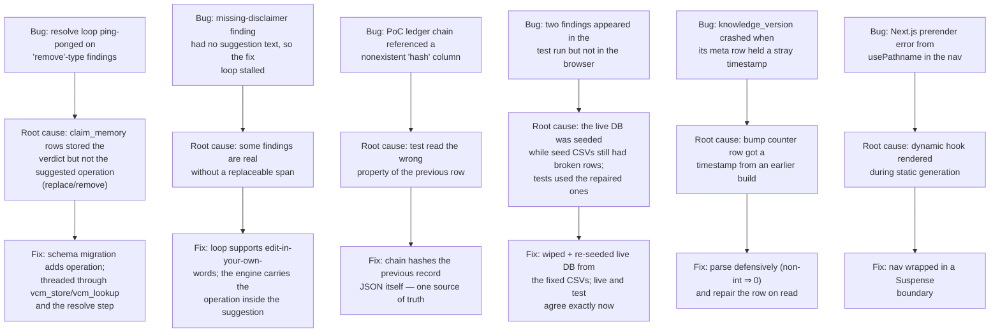

# Canonry — Approach: how we attacked this, and what we changed

> Companion to [architecture.md](architecture.md) / [design.md](design.md).
> This file is the honest record of *how* the build happened: the method, the
> sequencing, the failures encountered on the way, and every deviation from
> the Round 1 plan (the submission-form requirement: **explanation of any
> changes**).

---

## 1. The core problem, restated from the Round 1 plan

Marketing content is reviewed by people using a brand book that is:

- **ambiguous** — rules read like advice, without usable golden examples;
- **unsniffable** — there is no way to *check* a draft against rules/facts
  automatically; and
- **probabilistic by drift** — old facts (pricing, customer counts,
  certifications) live on in shipped content long after they stopped being
  true.

Our plan (Canonry) = turn the brand book from a *document* into a *runtime*:
content goes in, comes back with explained, cited issues, a human decides,
and the approval is provable after the fact — **detect, fix at the source,
prove**.

## 2. Approach — the build order we actually followed

(Build steps, not the plan's milestones M1–M10; milestone status is in
[plan-vs-build.md](plan-vs-build.md#2-milestones-section-112).)

```mermaid
flowchart LR
    S1["1 · Demo seed
rules, facts,
terms, personas"] -->
    S2["2 · Engine core
schema + rule checks"] -->
    S3["3 · Claim pipeline
retrieval, verdicts,
citation check, VCM"] -->
    S4["4 · Workflow
resolve, dispute,
review, override, router"] -->
    S5["5 · Proof of Compliance
Ed25519, ledger, /verify"] -->
    S6["6 · Web app
all screens,
demo personas"] -->
    S7["7 · Tests
suites drive
the real loop"] -->
    S8["8 · AI gateway
provider adapters,
key-less degradation"] -->
    S9["9 · Review pass
rule bindings, access,
lifecycle lock"]
```

Why this order (and why it mattered at hackathon pace):

1. **Seed data first**, because every decision downstream (what a "rule"
   looks like, what a fact record needs, what a "vague" rule is) came from
   actually writing 40 rules and 60 facts for a fictional brand.
2. **Engine before UI** because judges want the *clock-stopping* demo — a
   deliberately broken launch post returning red, explained highlights — but
   the demo's quality is the engine's, not the UI's.
3. **Contract written early** (`contract.py`) so the UI could be built
   against one frozen shape while the claim pipeline was still being
   debugged.
4. **Signing last-but-one** because the *approval → PoC → verify* chain is
   the demo's showpiece; it only worked once everything before it worked.

## 3. Techniques used (and why they're the right concentration)

| Area | Technique | Why — beginner explanation |
|------|-----------|---------------------------|
| Rule checks | regex + function patterns over a normalized text | A rule like "social posts ≤ 200 words" is cheap code; running an LLM for it is slow, money-burning and flaky. |
| Claim finding | regex trigger patterns in 5 categories (counts, prices, %, dates, certifications, superlatives) + span widening logic | New rules rarely arrive in new syntaxes; these 6 categories cover the overwhelming majority of real marketing claims. |
| Retrieval | substring token scoring over visible facts | Half the plan's promise is "every number must match a fact verbatim" — substring matching is the natural enforcement for that, and it never hallucinates. |
| AI use | one batched JSON call per task, strict JSON out, budget cap | Keeps the AI proportionate: implicit claims and tone, not everything. |
| Anti-hallucination | returned spans are only accepted if found **verbatim** in the text | Prevents any AI-fabricated issue from reaching the reviewer. |
| State model | immutable revisions + issue statuses (open/accepted/edited/disputed) + decisions | Reasoning must be reconstructable: this finding, on that text, resolved by this human, with reason. |
| Work artifacts | seeded SQLite; hash-chained audit; Ed25519 PoC | The "prove" quarter of the plan, all local, no infra to deploy. |
| Demo access | demo mode: seeded personas sign in without a password through a real engine `POST /login`; production mode uses passwords and invitations | A judge opens the link and uses the product without help; real sessions and role rules under the hood. |

## 4. Deviations from the Round 1 plan

Every change from the plan, section by section, with the reason and the upgrade
path, is in **[plan-vs-build.md](plan-vs-build.md)**. In short: SQLite instead
of Supabase Postgres (Postgres-compatible schema), exact keyword and number
matching instead of embeddings, inline checks instead of a queue, demo personas
plus password/invitation sign-in instead of Google sign-in, an AI call ledger
instead of Sentry/Langfuse, and text-only content this round.

## 5. Problems we hit and fixed (an honest engineering log)

Each fix is visible in the git history of this repo; nothing was papered
over — no tests skipped, no assertions weakened: every failing check pointed
at a real defect.

## 6. What "done" means to us, and how we measured it

Checked against the Round 2 judging criteria:

- **Core workflow runs end to end**: submit → findings → resolve → review →
  sign → public verify, driven through the API by `test_engine.py` and walked
  in the browser on the production build.
- **A judge can use it without help**: in demo mode there is no password; the
  dashboard already lists a deliberately broken Quillmark post and the seeded
  knowledge base, and each role is one seeded sign-in away.
- **Reliability**: 11 suites and an evaluation gate run in CI on every push
  (see the [README](../README.md#7-tests-and-reliability)).
- **Round 3**: the plan's milestones M7–M10 are unchanged; see
  [progress.md §5](progress.md#5-round-3-improvements-planned).
