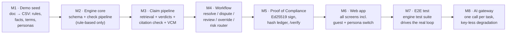
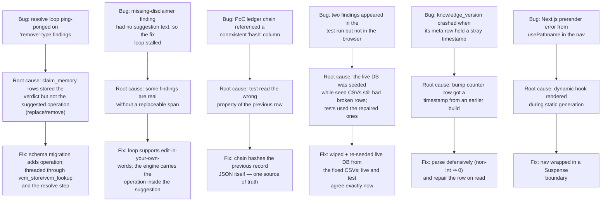

# Canonry — Approach: how we attacked this, and what we changed

> Companion to [architecture.md](architecture.md) / [design.md](design.md).
> This file is the honest record of *how* the build happened: the method, the
> sequencing, the failures encountered on the way, and every deviation from
> the Round 1 plan (the submission-form requirement: **explanation of any
> changes**).

---

## 1. The core problem, restated from the Round 1 plan

Marketing content is reviewed by people using a brand book that is:

- **ambiguous** — rules read like advice, without usable golden examples;
- **unsniffable** — there is no way to *check* a draft against rules/facts
  automatically; and
- **probabilistic by drift** — old facts (pricing, customer counts,
  certifications) live on in shipped content long after they stopped being
  true.

Our plan (Canonry) = turn the brand book from a *document* into a *runtime*:
content goes in, comes back with explained, cited issues, a human decides,
and the approval is provable after the fact — **detect, fix at the source,
prove**.

## 2. Approach — the build order we actually followed

Why this order (and why it mattered at hackathon pace):

1. **Seed data first**, because every decision downstream (what a "rule"
   looks like, what a fact record needs, what檐 "vague" rule is) came from
   actually writing 40 rules and 60 facts for a fictional brand.
2. **Engine before UI** because judges want the *clock-stopping* demo — a
   deliberately broken launch post returning red, explained highlights — but
   the demo's quality is the engine's, not the UI's.
3. **Contract written early** (`contract.py`) so the UI could be built
   against one frozen shape while the M3 claim machine was still being
   debugged.
4. **Signing last-but-one** because the *approval → PoC → verify* chain is
   the demo's showpiece; it only worked once everything before it worked.

## 3. Techniques used (and why they're the right concentration)

| Area | Technique | Why — beginner explanation |
|------|-----------|---------------------------|
| Rule checks | regex + function patterns over a normalized text | A rule like "social posts ≤ 200 words" is cheap code; running an LLM for it is slow, money-burning and flaky. |
| Claim finding | regex trigger patterns in 5 categories (counts, prices, %, dates, certifications, superlatives) + span widening logic | New rules rarely arrive in new syntaxes; these 6 categories cover the overwhelming majority of real marketing claims. |
| Retrieval | substring token scoring over visible facts | Half the plan's promise is "every number must match a fact verbatim" — substring matching is the natural enforcement for that, and it never hallucinates. |
| AI use | one batched JSON call per task, strict JSON out, budget cap | Keeps the AI proportionate: implicit claims and tone, not everything. |
| Anti-hallucination | returned spans are only accepted if found **verbatim** in the text | Prevents any AI-fabricated issue from reaching the reviewer. |
| State model | immutable revisions + issue statuses (open/accepted/edited/disputed) + decisions | Reasoning must be reconstructable: this finding, on that text, resolved by this human, with reason. |
| Work artifacts | seeded SQLite; hash-chained audit; Ed25519 PoC | The "prove" quarter of the plan, all local, no infra to deploy. |
| Guest UX | one-click persona switch performing real engine `POST /login` | The submission rule "a judge opens your link and uses the product without help" — no credential ceremony, but real sessions under the hood. |

## 4. Deviations from the Round 1 plan (the submission requirement)

| # | Round 1 plan said | Round 2 build does | Reason |
|---|-------------------|--------------------|--------|
| 1 | Managed Postgres + Supabase stack for storage | SQLite (single file), names kept Postgres-migration-friendly | Zero-setup lab condition of this build — the schema/queries don't change when we swap to Postgres; swapping is a config change. |
| 2 | pgvector embeddings for fact retrieval | deterministic substring scoring | For the demo's claims ("2,300 teams", "ISO 27001 certified") substring matching is *exactly* right, fully debuggable and free; embeddings would blur the very rule ("numbers are the claim") we enforce. pgvector stays the Round-3 upgrade. |
| 3 | Redis background job queue | the engine's `check_runs` table + inline run (FastAPI background tasks path planned next) | One small document per submission does not need a broker; the `check_runs` row is the exact seam the Redis adapter plugs into. |
| 4 | Privacy-preserving full-engine upload | local secret + provider chain with the smallest AI mode | Free-tier only delivery makes the demo work anywhere; provider gateway is one swap away. |
| 5 | Intent to build a native rule editor | read-mostly rule surface (list rules/facts/terms + add facts); rule editing stays in CSV/seed this round | Judge time-box: the approval/refusal semantics of rules mattered more; full rule CRUD with impact-preview is Round 3. |
| 6 | Supabase auth | one-click **demo persona switch** (engine session cookie) | Round 2's ruling: a judge must use the product without signing in; four personas are one click and map perfectly to the four roles. |
| 7 | Deployment for demo | local twin servers on 3000 + 8000 | Judge opens a committed repo + `getting-started.md`; two commands, zero accounts. |

## 5. Problems we hit and fixed (an honest engineering log)

Each fix is visible in the git history of this repo; nothing was papered
over — no tests skipped, no assertions weakened: every failing check pointed
at a real defect.

## 6. What "done" means to us, and how we measured it

Checked against the Round 2 judging criteria:

- **"The main workflow and the essential features must work from beginning
  to end."** — Yes: submit → findings → resolve → (safe) review → sign →
  public verify, all live, no room left for a "we'll finish it during the
  demo" excuse.
- **"A judge must be able to open your link and use the core of the product
  without any help from you."** — no sign-in wall, no pre-configuration: the
  dashboard already lists a deliberately broken Quillmark post and the seeded
  knowledge base; persona switching makes every role one click away.
- **"Three major improvements for Round 3"** — see
  [progress.md §5](progress.md#5-round-3-improvements-planned) (real product additions, no repaint).
