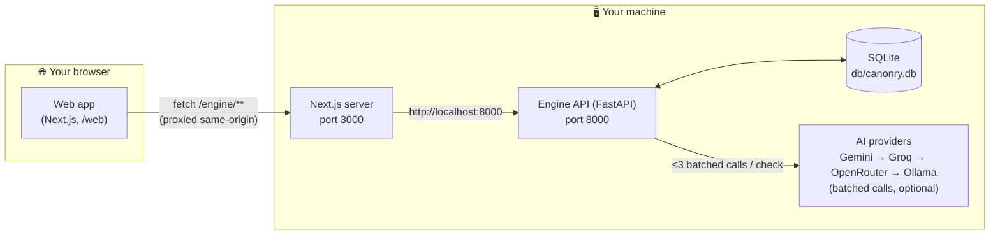
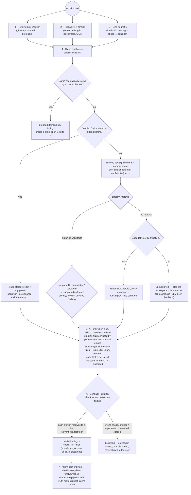
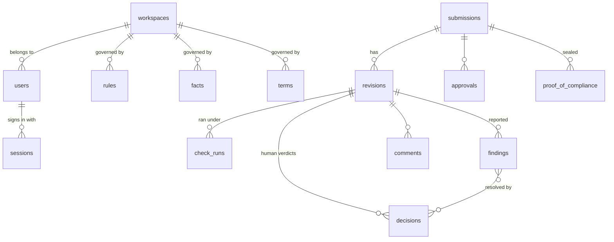
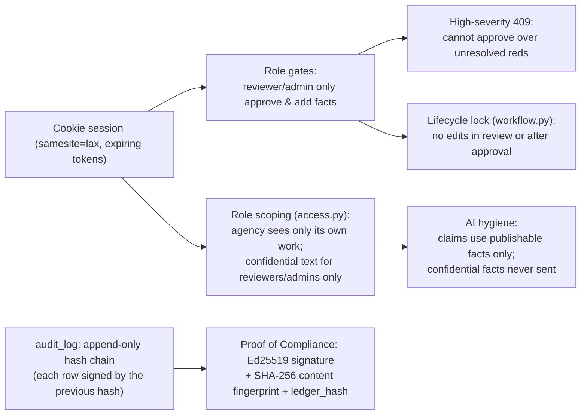
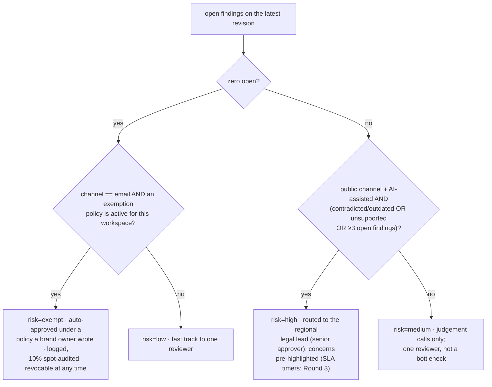

# Canonry — Architecture

> Read this if you want to understand *how the product works under the hood*.
> Written for a complete beginner: no prior knowledge of FastAPI, Next.js or
> cryptography is assumed — every term is explained where it first appears.

---

## 1. The system in one picture

Canonry is two small programs talking over HTTP:



**Beginner definitions**

| Term | What it means here |
|------|--------------------|
| **Engine (FastAPI)** | A Python program that listens for HTTP requests and answers with JSON. It owns *all* of the intelligence: checkers, claim logic, signing. |
| **Web (Next.js)** | The React program that draws the screens. It contains **no product logic** — it only requests and displays. |
| **SQLite** | A single-file relational database. Lives in `db/canonry.db`; created and seeded automatically on first start. |
| **Same-origin proxy** | `web/next.config.ts` rewrites `/engine/*` to `http://localhost:8000/*`. Benefit: the browser always talks to one address, so session cookies "just work" and there are no CORS errors. |
| **Finding** | One reported issue: a highlighted text span + explanation + citation + suggestion + certainty tier. The atom the whole product is built around. |

Why two services? The plan specified them as separately deployable
(engine later on Supabase Postgres + the web anywhere), and the **Finding
Contract** (Section 4) makes them independently testable.

---

## 2. Request lifecycle — the core loop

This is the journey a single submission takes. Every step is wired and
working in this build.

```mermaid
sequenceDiagram
    autonumber
    participant U as Creator (e.g. Arjun)
    participant W as Web (Next.js)
    participant E as Engine (FastAPI)
    participant K as SQLite

    U->>W: Paste content, pick channel + source type
    W->>E: POST /engine/submissions
    E->>K: create submission (Draft) + revision 1
    E->>E: run_check(revision) — the pipeline (Section 3)
    E->>K: persist findings + check_run (with knowledge_version)
    E-->>W: findings card list
    W-->>U: highlighted text + findings panel

    U->>W: Accept fix / Edit in own words / Dispute with reason
    W->>E: POST /engine/submissions/{id}/resolve
    E->>K: decisions row + finding status → new revision N+1
    E->>E: run_check again (VCM makes repeats instant)
    E-->>W: updated findings ("Signed?" only when cleared)

    U->>W: Submit for review
    W->>E: POST /engine/submissions/{id}/submit-review
    E->>E: compute_risk() → low / medium / high / exempt
    E->>K: status = In review (+ router note)

    U->>W: (as reviewer) Approve / Request changes / Override
    W->>E: POST /engine/submissions/{id}/review
    E->>E: hard block: open high-severity ⇒ 409
    E->>K: approvals row; writing.sign_approval()
    E-->>W: PoC id → app status **Signed**
```

Steps 1–6 are the *checks* half of the promise, steps 7–11 the *human
decides* and *provable* halves.

---

## 3. The check pipeline (what happens inside one "Check" click)



Design rule from the plan, kept literally: **rules before AI**. The AI runs
at most 3 batched calls per 1 000 words (enforced by
`gateway.call_budget_ok`) and *only* for what regex could not do: implicit
claims and tone. Every built-in check cites the rule its workspace binds to it
(`engine/policy.py`); a retired rule switches its check off. With no API key,
steps 1–4 + 6 still deliver their findings;
step 5 is marked **ai_pending** on the check run (never silently skipped)
and the Insights page shows the provider ledger as “no provider configured”.

---

## 4. The Finding Contract (`finding@1`)

Every checker (now and in Round 3) emits findings in one shape, defined first
and versioned. This is what makes the UI checker-agnostic and keeps the two
services independently testable.

```
{
  "id": "fnd_66acf0_104_188",               ← deterministic id (revision + span + offset)
  "revision_id": "rev_…",
  "checker": "terminology | readability | claims | tone | confidential | …",
  "category": "banned_term | contradicted_claim | outdated_claim | …",
  "span": { "start": 81, "end": 96, "text": "trusted by 5,000+" },
  "tier":      "definite | likely | consider",   ← certainty: does the evidence prove the violation?
  "severity":  "high | medium | low",            ← impact if wrong
  "citations": [ { "type": "fact | rule | term | pack", "id": "F-012", "version": 3 } ],
  "explanation": "one human sentence citing the rule/fact id",
  "suggestion": { "replace": "trusted by 2,300+", "operation": "replace | remove" },
  "provenance": { "model": "gemini-2.5-flash" | null, "prompt_version", "knowledge_version": 421 },
}
```

Every finding is validated against this contract (pydantic, `engine/contract.py`)
before it is stored; one that does not conform is discarded and counted, like a
finding with a dead citation. Tier and
severity are deliberately **separate axes** — see
[design.md §3](design.md#3-certainty-vs-impact-the-three-tier--severity-matrix).

---

## 5. Data model (SQLite, managed-Postgres-ready)



| Table | Keeps | Notable columns |
|-------|-------|-----------------|
| `workspaces` | one brand = Quillmark (seeded) | — |
| `users` | 4 demo personas with roles | `role: creator / agency / reviewer / admin` |
| `sessions` | cookie tokens, expiring | — |
| `rules` | brand-book statements | `version, status(approved/retired), vague_flag` |
| `rule_bindings` | which rule each built-in check cites | `check_key → rule_id` per workspace |
| `knowledge_history` | every version of every rule, fact and term | `snapshot_json, reason, by_user, knowledge_version` |
| `invitations` | production sign-up (one-use, role-bound) | `token_hash, email, role, expires_at, consumed_at` |
| `facts` | approved truth, one-claim size | `owner, source, valid_from/to, confidential, superseded` |
| `terms` | preferred/banned glossary | note → parsed into rule/fact citations |
| `submissions` | one content piece | `status, risk, router_note` |
| `revisions` | immutable text snapshots | `revision_no` — never edited in place |
| `check_runs` | one pipeline run | `knowledge_version` — re-checkability proof |
| `findings` | reported issues | `citations_json, suggestion_json, provenance_json, status` |
| `decisions` | accept / edit / dispute / override rows | `replacement, reason, by_user` |
| `approvals` | review outcomes | action rows incl. `exempt_approve` |
| `proof_of_compliance` | signed seals | `record_json, content_sha256, signature, public_key_fingerprint` |
| `claim_memory` (VCM) | claim → verdict cache | `claim_norm, numbers_json` |
| `ai_calls` | the AI ledger | `task, provider, model, prompt_version, latency_ms, ok` |
| `audit_log` | every human action | `prev_hash, hash` — append-only chain |
| `exempt_policies` | auto-approve lanes | `scope, active` |
| `meta` | counters, like `knowledge_version` | — |

Why SQLite but named like Postgres? The plan targets Supabase Postgres +
pgvector for the managed build; the prototype keeps **compatible table and
column names** so that migration is a config change, not a redesign. SQLite
quirks are isolated in one module (`engine/db.py`: `json_extract` only where
SQLite supports it, all dates stored as ISO-8601 strings).

---

## 6. Security & tamper-evidence layers



- **Hash-chained audit log**: row *n* stores the SHA-256 of row *n−1's*
  payload, so past rows cannot be rewritten without breaking the chain.
- **Proof of Compliance** (`engine/signing.py`): the record
  (content fingerprint, approver, role, rules_version, time) is canonicalised
  (sorted JSON, yes — that exact ordering matters) and signed with Ed25519
  (PyNaCl). `GET /verify/{poc_id}` checks the seal itself; `POST /verify/{poc_id}`
  with the published text answers `verified / modified / unknown` (spacing-only
  differences still verify, with a note). Usable by anyone, no login; the public
  answer shows the approver's role, never an email.

---

## 7. The Canon Connector (MCP) — prevention, not detection

`engine/mcp_server.py` is an MCP (Model Context Protocol) server over stdio
JSON-RPC: the same wire format Claude Code / Cursor / MCP Inspector speak.
Its two tools let an AI editor ask the brand instead of inventing:

```
look_up_fact(query, as_source)   ← approved facts for a topic; agency never
                                    receives confidential facts
check_claim(claim, as_source)    ← supported / contradicted / outdated /
                                   unsupported + the fact id behind it
```

This is the *prevention* half of “detect + fix at the source + prove” (plan
§5.4): fixing claims **before** they are written, so the checker sees fewer.
Confidential facts are never returned to `as_source=agency` callers.

---

## 8. Key algorithms explained simply

### a) Claim normalisation (Verified Claim Memory)

VCM answers: *“have we judged this exact claim before?”* Judgements are keyed
by `kind + numbers + units + salient names`, because a verdict for
`trusted by 2,300+ teams` must **not** confirm `trusted by 3,200+ teams`
(F011/CLM “numbers are the claim” rule from the plan).

```
"trusted by 5,000+ teams" → kind=count, numbers=[5000] → key "count|5000|teams|quillmark? no (salient filter)"
```

If the key exists, the stored verdict is re-used — including reserved
 corrective operations — and provenance stamps `claim-memory:rule-patterns`
 on the finding. Cache misses go through the retrieval path, then write
 themselves into VCM so the *next* identical claim costs nothing.

### b) Retrieval scoring (`claims.retrieve_facts`)

For each candidate fact (only facts visible to the actor's role, active today):

```
score = substring overlap of salient tokens (≥3 letters, lowercased)
      + decimal/number-pair proximity bonus + unit agreement
```

The highest scorers above a threshold are the *retrieved set* for
verification; a strict `classify_match()` step labels the claim (support /
contradict / outdated / unsupported) from those facts. Prototype-simple; the
Round-3 swap is pgvector embeddings with **no contract change**.

### c) Compute elevation & approval math (`main.compute_risk`)



Approval math (`main.review`): count of open high-severity findings > 0 ⇒
HTTP 409 — approval is refused until each red finding is resolved **or
explicitly overridden with a reason** (the override path writes both a
decision row and an approvals row). Otherwise an approval row is written,
`signing.sign_approval()` generates the Ed25519 seal into
`proof_of_compliance`, and the submission becomes status **Signed** with a
PoC id the public `/verify/[pocId]` page resolves without login.

---

## 9. Frontend structure (Next.js App Router)

```
web/src/
├── app/                     ← App Router: folder = URL
│   ├── page.tsx             ← dashboard: stats + submission list
│   ├── new/page.tsx         ← New submission form (prefilled demo post)
│   ├── submissions/[id]/    ← server page + client detail (the core screen)
│   ├── kb/ (page.tsx)       ← knowledge base (rules / facts / terms add + list)
│   ├── insights/page.tsx    ← disputes, expiry alerts, AI ledger, "unclear rules"
│   └── verify/[pocId]/      ← PUBLIC: PoC seal status (needn't be logged in)
├── components/
│   ├── top-nav.tsx          ← persona switcher (one-click demo login)
│   └── ui/*                 ← shadcn primitives (button, card, tabs, badge…)
└── lib/
    ├── api.ts               ← typed client for every engine endpoint
    └── personas.ts          ← demo persona table (single source of truth)
```

Two easy-to-miss details for reviewers: the submission detail page is a
Server Component that fetches once and hydrates a small client tree
(`submissions/[id]/detail.tsx`), and *everything* is reachable with **no
credentials** — the nav's persona switcher performs the engine's
`POST /login` round-trip and drops an httpOnly cookie.

---

## 10. Module interfaces (where to extend)

Each cross-cutting rule lives in exactly one module behind a small interface, so
a change happens in one place and every endpoint follows it.

| Concern | Interface | Extend by |
|---|---|---|
| Which rule a check enforces | `policy.CHECKS`, `policy.rule_for(conn, ws, key)`, `Ctx.rule(key)` in checkers | adding a `Check` (key + baseline rule); a workspace can bind it to its own rule |
| What a status allows | `workflow.blocked(status, action)`, `workflow.allowed(status)` | adding an action or status to `workflow.ALLOWED`; the UI reads `allowed` from the detail payload |
| What a role may see | `access.submission_scope(user)`, `access.filter_visible(...)`, `access.redact_fact(...)` | changing the rule once; every cross-submission query uses it |
| AI providers | `gateway.Provider` (`available`, `model`, `chat`), `gateway.gateway_call(task, messages, ...)` | subclassing `Provider`, or adding an `OpenAICompatible(...)` entry to `gateway.PROVIDERS` |
| What a finding looks like | `contract.Finding`, `contract.conforms(finding)` | a new checker returns this shape; the pipeline validates it |

---

## 11. Glossary of terms found in the code

| Code name | Plain meaning |
|-----------|----------------|
| `Ctx` | the little context object every checker gets (db, revision, channel, source, knowledge_version) |
| `knowledge_version` | cheap fingerprint of rulebook+facts+terms rowids; stored on every check_run so old runs are reproducible |
| `VCM` / `claim_memory` | Verified Claim Memory (§8a) |
| `DISCARD | discarded` | findings removed by the citation check; counted, not hidden |
| `tier` | how certain we are the violation is real (definite/likely/consider) |
| `severity` | how hard it hurts if the content ships (high/medium/low) |
| `override` | reviewer's explicit yes-with-reason on a finding they judged non-blocking |
| `PoC` | proof-of-compliance seal, not "proof of concept", in this product |
| `MCP` | Model Context Protocol — the standard way AI tools call external tools |
