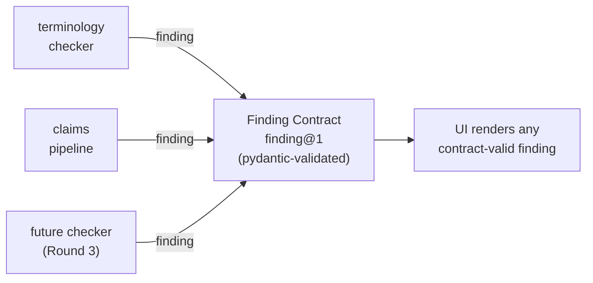
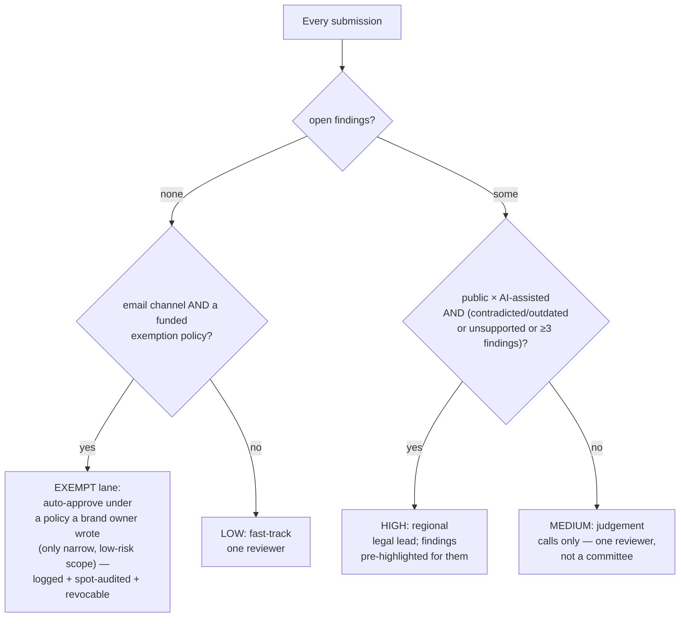
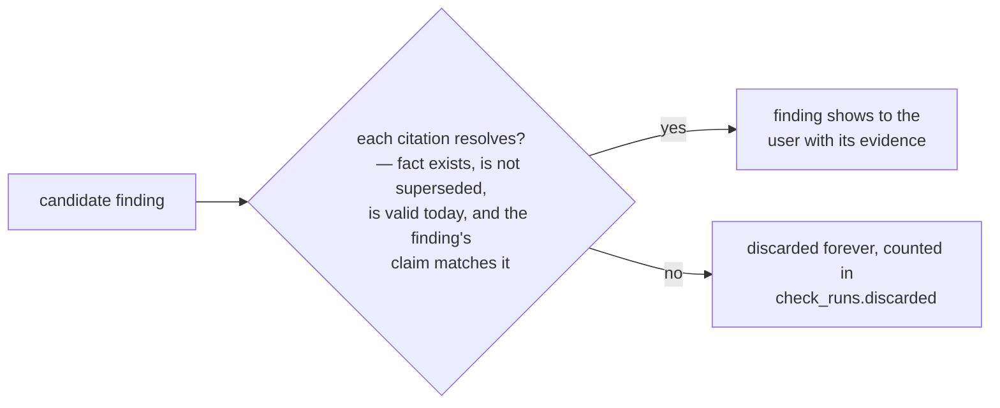

# Canonry — Design: product rules and the thinking behind them

> Companion to [architecture.md](architecture.md) (which explains *how things
> work*). This file explains *why they work that way*. Written so a complete
> beginner (or a judge) follows every decision without needing the code.

---

## 1. The four product principles (inherited from the Round 1 plan)

| # | Principle | Where you see it in the product |
|---|-----------|--------------------------------|
| P1 | **Rules before AI** — deterministic checks are free, fast and certain; the AI only fills what patterns cannot | Pipeline order (terminology/readability/tone → claims → 1 AI call); AI ledger on Insights |
| P2 | **No citation, no finding** — a finding that can't point to a real, live rule/fact/term is discarded | `claims.citation_check()`; `check_runs.discarded` counter |
| P3 | **Human decides, AI never ships independently** — findings suggest; reviewers approve/override with reasons | high-severity 409 on approve; override requires a reason; every verdict logged |
| P4 | **Proof, not trust** — approvals are cryptographically sealed and publicly verifiable | Ed25519 PoC + public `/verify/[pocId]` page |

Every design decision below traces to one of these.

## 2. The Finding Contract — why it exists

Rewriting checkers is cheap; rewriting the UI is not. The contract fixes the
*shape* of an issue so new checkers plug in without UI changes:

Rules inside it:

- **`span` is verbatim-consistent.** The span's text must exist exactly at
  `start..end` in the revision text — otherwise the highlighted UI would be
  impossible. AI-returned spans that can't be located in the text are dropped,
  which is precisely where careless AI demos "hallucinate issues".
- **`tier` and `severity` are separate.** See §3.
- **`provenance` is mandatory.** Every finding says which model (if any),
  which prompt version and which knowledge_version produced it — the audit
  basis for the reviewer.
- **Version string** (`finding@1`, `claims@4`, `tone@1`) flows through the
  ledger so historical output can always be reproduced.

## 3. Certainty vs impact — the three-tier × severity matrix

The heart of "deterministic first". One axis is *how sure we are* (evidence),
the other is *how hard it hurts* (impact). Keeping them apart is what lets a
reviewer trust fast lanes and treat slow lanes carefully.

| | **high severity** | **medium severity** | **low severity** |
|---|---|---|---|
| **definite tier** (rule matched exactly) | 🔴 Blocks approval — e.g. contradicted claim (“We served 5,000+ teams” vs a fact saying 2,300+) | Orange, fix before sign-off — banned term with an approved replacement | fine-grain nit |
| **likely tier** (retrieval says so) | — | orange — checker was `likely`; a reviewer confirms | — |
| **consider tier** (judgement call: tone, readability) | — | sentence-limit & `!`-abuse, CTA missing | small polish notes |

Consequences wired in the product:

1. **Approve is refused while any high-severity finding is open** (HTTP 409
   with a plain-language message) — P3.
2. **Low/consider findings never block; medium needs one reviewer**; the
   router decides *who* — see §4.
3. The UI orders findings by tier then severity, so the reviewer's eyes land
   on red first.

## 4. Risk router — who reviews what

Why bother with an exempt lane at all? Because 100% human review is exactly
the bottleneck that kills this workflow today. But an auto-approval must be
**narrow, written by a human, loudly logged and cheap to cancel** — which is
what `exempt_policies` stores.

## 5. Why "Verified Claim Memory" (VCM)

Checking the same claim costs the same twice — wasteful, and worse: *AI
verdicts can differ on repeat calls*, which erodes reviewer trust. VCM fixes
both:

- **Key = kind + exact numbers + units + salient brand names.** Relaxed keys
  would let `2,300+` quietly confirm `3,200+`, an unacceptable drift. The
  strict key is the point.
- **Stores** verdict, supporting fact ids, explanation, suggestion and the
  suggested operation (replace/remove) — so a repeat claim re-finds a verdict
  instantly and stably.
- **Provenance tag** `claim-memory:rule-patterns` (or the model it came from)
  marks re-used verdicts so reviewers can trust vs re-examine.

## 6. Why "no citation, no finding" is a hard gate (P2)

An unexplained red underline is exactly what makes current review tools
ignored. Citation-check enforces the product's credibility:

The user-visible payoff: every finding you read carries its own evidence line
(`rule CLM-01 requires every statistic to trace…`, fact excerpt, expiry
date). And because discarded findings are *counted*, silent drops stay
auditable rather than invisible.

## 7. Names you'll see in seeded data — the Quillmark demo world

A fictional SaaS, `Quillmark Analytics`, with the four humans from the plan's
walkthrough (§6.2), so judges can replay the exact Round-1 story:

| Person | Role | What they do in the demo |
|--------|------|--------------------------|
| Arjun (Product Marketer) | creator | submits the deliberately broken launch post; resolves findings |
| Maya (Brand & Content Manager) | reviewer | routine approvals, requests changes |
| Riya (Agency Copywriter) | agency | submits via agency source; never sees confidential facts |
| Karan (Head of Marketing) | admin | final approver + explicit overrides + exemption policies |

Plus deliberately shipped imperfections — a few `vague_flag` rules with no
usable examples, an expiring fact (`F-102 Pulse Insights 2025 pricing`),
a superseded fact — so Insights' "possibly unclear rules" and expiry-alert
panels have real content instead of empty additions.

## 8. Explicit decisions we recorded (mini ADR list)

| Decision | Chose | Instead of | Because |
|----------|-------|-----------|---------|
| D1 Checker architecture | independent deterministic checkers + one AI batched pass | everything through one LLM | latency, cost, and P2 evidence quality — deterministic claims never hallucinate |
| D2 Findings persistence | findings stored **per revision**, immutable | overwriting in place | revisions must stay reproducible under `knowledge_version` |
| D3 AI provisioning | provider fallback chain (Gemini→Groq→OpenRouter) + honest key-less mode | require a paid key | demo must run anywhere, free tiers vary by region |
| D4 Rewrite safety | suggestion carries an `operation` flag (replace/remove), never free-form text injection | let the AI rewrite whole paragraphs | reviewers accept spans, not essays — reviewability is the whole point |
| D5 Signing | Ed25519 via PyNaCl + SHA-256 over canonical JSON | JWT / HMAC | non-repudiable, tiny keys, canonicalisation is what makes verify deterministic |
| D6 Audit log | hash-chained append-only table | plain timestamps | tamper-evidence without a blockchain |
| D7 MCP connector | JSON-RPC 2.0 stdio by hand | wait for an SDK | we control the wire precisely today; SDK upgrade is additive later |
| D8 Role model | 4 fixed demo roles, no RBAC UI | generic roles console | judge entertainment value of the concrete story vs the abstraction |
| D9 Test approach | one end-to-end engine scenario (TestClient) driving the actual loop | unit-per-function only | simulates the real user journey: check → dispute → fix → sign → verify |
| D10 Vague-rule policy | surface vague rules in Insights, do not enforce | hide / auto-fail them | flagging invites the owner to rewrite the rule — it must not gaslight reviewers |

## 9. What "beginner level" built-ins are (worth knowing)

- **HTTP statuses you may meet while using it**: `409` on approve-with-open-highs, `401` if your session expired (persona switcher counts as login), `403` for reviewer-only actions.
- **IDs**: `sub_xxxx`, `rev_xxxx`, `fnd_xxxx`, `poc_xxxx`… short random hex; check_runs, findings, decisions get theirs on creation.
- **The engine's state is bounded**: a full happy-path review cycle fits in one SQLite file — dev servers can be wiped and reseeded with zero ceremony (`rm db/*.db* && restart`).
