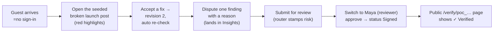

# Canonry — Progress log

> Companion to [approach.md](approach.md). This is the running record of what
> is **shipped and working**, what is verified, what is consciously left for
> Round 3 — written so a judge or teammate can pick up the state in one read.

---

## 1. Status snapshot

| Area | Status | Evidence |
|------|--------|----------|
| Engine core (schema, seed, checkers, claims, contract) | ✅ done | `engine/test_engine.py` — ALL ENGINE TESTS PASSED |
| Claim pipeline (retrieval, verdicts, VCM, citation check) | ✅ done | same test suite |
| Workflow (resolve, dispute, review, override, risk router) | ✅ done | test suite + driven live in the browser |
| Proof of Compliance (Ed25519 + ledger + public /verify) | ✅ done | signing + verify exercised in test and in UI |
| Insights panels (expiry alerts, AI ledger, unclear rules) | ✅ done | page renders real seeded + generated data |
| MCP Canon Connector | ✅ done | `engine/mcp_server.py` (stdio JSON-RPC, MCP wire format) |
| Web app — all 7 screens | ✅ done | dashboard / new / submission detail / KB / insights / verify / persona nav |
| Guest access — no sign-in needed | ✅ done | persona switcher performs real engine login; judge clicks and works |
| AI gateway (3 providers, key-less honest mode) | ✅ done | runs key-less (marks AI checks pending) — see §4 for the one key that lights it up |
| Documentation | ✅ done | README + docs/architecture, design, approach, progress, getting-started |
| Deployment to a public URL | ⏳ pending | local twin servers today; see §5 for the deployment checklist to close before submitting |

## 2. Demo journey — verified end to end (both via HTTP and in the browser)



Verified behaviours:

- Guest auto-login as a creator on first visit; one-click switch to the
  reviewer persona for the approve step.
- Accept-fix creates revision 2 with the corrected content and re-checks
  automatically (VCM makes repeat spans instant).
- Dispute requires a reason and shows in Insights → disputes feed.
- Approve is refused (HTTP 409) while a high-severity finding is open, with
  the policy message in plain language; the override path exists for the
  explicit human yes-with-reason.
- Clean content runs through the router (low/medium/exempt), approves, gets a
  PoC, and the public verify page answers `verified`.
- Insights and KB pages render with real data; no console errors; no
  prerender warnings.

## 3. What is deliberately NOT in Round 2 (and why that's fine)

| Left out | Why it's fine for this round | Round 3 |
|----------|------------------------------|---------|
| Live pgvector retrieval | substring matching is the *correct* tool for the demo's claims; embeddings blur the exact-number rule | swap-in is a config change (schema already compatible) |
| Production auth (Supabase) | judges must not need accounts; personas cover 4 roles | real seats for the managed build |
| Rule editor UI at full CRUD | engine endpoints exist; surface is read-mostly | full CRUD + impact preview |
| Redis task queue | one revision = one short inline run is fast enough | Redis adapter behind the `check_runs` seam |
| AI key configured (optional) | product degrades honestly and everything deterministic still works | see §4 |

## 4. The one optional switch: an AI key

The gateway is key-less right now. Everything deterministic works; the AI
assisted checks (implicit claims + tone) are marked **pending** — the
`check_runs.status` shows `ai_pending`, and Insights lists providers as
available/unavailable. That is *by design*, per the plan's degradation rule.

To light it up (optional, judge-invisible either way):

1. Create a **free** key (e.g. `https://aistudio.google.com/apikey`).
2. Copy `.env.example` → `.env` in the project root and paste the key.
3. Restart the engine. The AI ledger on Insights starts recording real calls.

The key is read only from the root `.env` at runtime — never logged, never
committed.

## 5. Round 3 improvements planned

(The submission requires three major real features — not cosmetic tweaks.)

1. **pgvector-backed Fact Library retrieval on managed Postgres (Supabase)**
   — deterministic claims stay substring-fast; embedding retrieval opens
   implicit claim coverage beyond regex patterns. Selected facts get monthly
   approval summaries to keep the library curated.
2. **Rule editor with impact preview** — create/edit rules in-product; before
   saving, show *which shipped content would newly break* under the proposed
   rule (the "impacted approved content" the engine already computes on the
   rule-test endpoint), so owners know what a rule change unstitches.
3. **Reviewer-inbox with SLA timers + reviewer workload balancing** — router
   stamps already carry SLA minutes; showing queues per reviewer, escalation
   after deadline, and post-hoc reviewer-agreement stats (which findings
   reviewers actually override) closes the loop into rule and model tuning.

## 6. Verification commands (run any time)

```bash
# engine end-to-end suite (fresh test DB; never touches the live DB)
cd engine && ../.venv/Scripts/python test_engine.py

# API smoke without the browser
curl -s http://localhost:8000/ai-status | head -c 300

# pages should answer 200 / 307 (guest redirect-handled)
curl -s -o /dev/null -w "%{http_code}\n" http://localhost:3000/
curl -s -o /dev/null -w "%{http_code}\n" http://localhost:3000/insights
curl -s -o /dev/null -w "%{http_code}\n" http://localhost:3000/verify/<poc_id>
```

The test suite boots its own `db/canonry_test.db` from the seed CSVs, so it
never disturbs the demo state in `db/canonry.db`.

## 7. Known small gaps (honesty list)

- AI checks stay `pending` until a key exists in the root `.env` (by design;
  see §4).
- First-run `next dev` can pick a different port when 3000 is busy — the
  engine URL is fixed at 8000, so the web proxy setting is the only thing
  to double-check in that case.
- PoC verify answers `modified` (not `failed`) when live content no longer
  matches the fingerprint — that is correct semantics, but worth reading as
  reviewer: someone changed the copy after signing.
