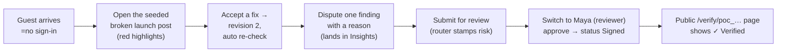

# Canonry — Progress log

> Companion to [approach.md](approach.md). This is the running record of what
> is **shipped and working**, what is verified, what is consciously left for
> Round 3 — written so a judge or teammate can pick up the state in one read.

---

## 1. Status snapshot

| Area | Status | Evidence |
|------|--------|----------|
| Engine core (schema, seed, checkers, claims, contract) | ✅ done | `engine/tests/test_engine.py` — ALL ENGINE TESTS PASSED |
| Claim pipeline (retrieval, verdicts, VCM, citation check) | ✅ done | same test suite |
| Workflow (resolve, dispute, review, override, risk router) | ✅ done | test suite + driven live in the browser |
| Proof of Compliance (Ed25519 + ledger + public /verify) | ✅ done | signing + verify exercised in test and in UI |
| Insights panels (expiry alerts, AI ledger, unclear rules) | ✅ done | page renders real seeded + generated data |
| MCP Canon Connector | ✅ done | `engine/mcp_server.py` (stdio JSON-RPC, MCP wire format) |
| Web app — all 7 screens | ✅ done | dashboard / new / submission detail / KB / insights / verify / persona nav |
| Guest access — no sign-in needed | ✅ done | persona switcher performs real engine login; judge clicks and works |
| AI gateway (3 providers, key-less honest mode) | ✅ done | runs key-less (marks AI checks pending) — see §4 for the one key that lights it up |
| Documentation | ✅ done | README + docs/architecture, design, approach, progress, getting-started, tutorial, changelog, disclosure-log, deployment, usability kit |
| Test suites (`engine/tests/`, 10 suites + evaluation gate) | ✅ done | checks over validation, insights shape, number formats, counts, rule preview |
| Evaluation baseline (Appendix B) | ✅ done | `engine/evaluation/evaluate.py` + `eval_set.jsonl` (20 samples, ~30% frozen) + `eval_baseline.json`; every run stored in `eval_runs` |
| CI gates (Section 11.5) | ✅ done | `.github/workflows/ci.yml`: six suites, evaluation gate, type-check, production build, `pip-audit`, `npm audit` |
| Deployment to a public URL | ⏳ pending (accounts needed) | artifacts ready: `engine/Dockerfile`, `render.yaml`, `docs/deployment.md` with verify steps; only the host accounts are missing |

## 2. Demo journey — verified end to end (both via HTTP and in the browser)



Verified behaviours:

- Guest auto-login as a creator on first visit; one-click switch to the
  reviewer persona for the approve step.
- Accept-fix creates revision 2 with the corrected content and re-checks
  automatically (VCM makes repeat spans instant).
- Dispute requires a reason and shows in Insights → disputes feed.
- Approve is refused (HTTP 409) while a high-severity finding is open, with
  the policy message in plain language; the override path exists for the
  explicit human yes-with-reason.
- Clean content runs through the router (low/medium/exempt), approves, gets a
  PoC, and the public verify page answers `verified`.
- Insights and KB pages render with real data; no console errors; no
  prerender warnings.

## 3. What is deliberately NOT in Round 2 (and why that's fine)

| Left out | Why it's fine for this round | Round 3 |
|----------|------------------------------|---------|
| Live pgvector retrieval | substring matching is the *correct* tool for the demo's claims; embeddings blur the exact-number rule | swap-in is a config change (schema already compatible) |
| Production auth (Supabase) | judges must not need accounts; personas cover 4 roles | real seats for the managed build |
| Rule editor UI at full CRUD | engine endpoints exist; surface is read-mostly | full CRUD + impact preview |
| Redis task queue | one revision = one short inline run is fast enough | Redis adapter behind the `check_runs` seam |
| AI key configured (optional) | product degrades honestly and everything deterministic still works | see §4 |

## 4. The one optional switch: an AI key

The gateway is key-less right now. Everything deterministic works; the AI
assisted checks (implicit claims + tone) are marked **pending** — the
`check_runs.status` shows `ai_pending`, and Insights lists providers as
available/unavailable. That is *by design*, per the plan's degradation rule.

To light it up (optional, judge-invisible either way):

1. Create a **free** key (e.g. `https://aistudio.google.com/apikey`).
2. Copy `.env.example` → `.env` in the project root and paste the key.
3. Restart the engine. The AI ledger on Insights starts recording real calls.

The key is read only from the root `.env` at runtime — never logged, never
committed.

## 5. Round 3 improvements planned

(The submission requires three major real features — not cosmetic tweaks.)

1. **pgvector-backed Fact Library retrieval on managed Postgres (Supabase)**
   — deterministic claims stay substring-fast; embedding retrieval opens
   implicit claim coverage beyond regex patterns. Selected facts get monthly
   approval summaries to keep the library curated.
2. **Rule editor with impact preview** — create/edit rules in-product; before
   saving, show *which shipped content would newly break* under the proposed
   rule (the "impacted approved content" the engine already computes on the
   rule-test endpoint), so owners know what a rule change unstitches.
3. **Reviewer-inbox with SLA timers + reviewer workload balancing** — the router
   already assigns risk and reviewer level; adding SLA deadlines, queues per
   reviewer, escalation after a deadline, and post-hoc reviewer-agreement stats (which findings
   reviewers actually override) closes the loop into rule and model tuning.

## 6. Verification commands (run any time)

```bash
# every suite (each on its own fresh DB) + the evaluation gate
.venv/Scripts/python engine/tests/run_tests.py

# evaluation baseline and the CI gate (Appendix B, frozen split)
.venv/Scripts/python engine/evaluation/evaluate.py           # full report, all splits
.venv/Scripts/python engine/evaluation/evaluate.py --check   # exit 1 on regression or a missed target

# API smoke without the browser
curl -s http://localhost:8000/ai-status | head -c 300

# pages should answer 200 / 307 (guest redirect-handled)
curl -s -o /dev/null -w "%{http_code}\n" http://localhost:3000/
curl -s -o /dev/null -w "%{http_code}\n" http://localhost:3000/insights
curl -s -o /dev/null -w "%{http_code}\n" http://localhost:3000/verify/<poc_id>
```

The test suite boots its own `db/canonry_test.db` from the seed CSVs, so it
never disturbs the demo state in `db/canonry.db`.

## 7. Hardening pass — 2026-10-27 (bugs found by testing, all fixed)

Eight defects were found by adding `engine/tests/test_edge_cases.py` (29 checks) and
probing the API where the original suites had no coverage. Each fix is covered
by that suite, and the five older suites still pass unchanged.

| # | Bug (before) | Fix |
|---|--------------|-----|
| 1 | `POST /login` accepted any string — an empty or malformed email created a user with a blank name | email format + length validated (422) |
| 2 | An unknown `resolve` action crashed with a 500 (KeyError) | validated up front (422); refused actions write nothing |
| 3 | `edit` without replacement text silently recorded a no-op decision | refused (422) |
| 4 | `accept` on a finding with no automatic fix recorded a no-op and re-queued the same check forever | refused (409) with a pointer to edit/dispute |
| 5 | Reviewer `override` accepted a finding id that did not exist on the current revision — decision + approval rows were written for a ghost | 404 (unknown) / 409 (already decided) before any write |
| 6 | `/insights` returned only the first decision row in the wrong shape (`{"action": "accept", "c": 12}`) instead of an action→count map | full grouped map, matching the web type |
| 7 | Number formatting was treated as a claim difference: “2300+ teams” was flagged *contradicted* against the fact “2,300+ teams” | numbers compared by value (`2300 == 2,300`) |
| 8 | Dashboard `open_findings` summed findings across **all** revisions, so a Signed item could show a stale “15 open findings” | counts the latest revision only |
| 9 | A sentence containing a decimal (“4.2 crore”) was split at the dot, so long-sentence readability checks missed real cases | one sentence splitter everywhere (a full stop ends a sentence only before whitespace) |
| 10 | Next 16 dev console logged “Could not validate that a segment … has instant navigation” for every gated route | documented opt-out: `experimental.instantInsights.validationLevel: "manual-warning"` (the app renders behind `<IdentityGate>`, so no route claims an instant shell) |

## 8. Review pass — 2026-10-28 (found by a code review and browser checks; each proven by a failing test or screenshot first)

| # | Defect (before) | Fix | Test |
|---|---|---|---|
| 1 | Checks cited rule ids written into the code (CLM-01, VOICE-3.2, SOC-01, MSG-03 ...). In any rulebook other than the demo's, the citation check discarded most claim, tone and readability findings | rule bindings (`engine/policy.py`): each check cites the workspace's own rule; baseline rules for a fresh workspace; a retired rule switches its check off | `test_policy.py` |
| 2 | The agency role read other creators' titles and dispute reasons in `/insights`, others' work in stale approvals and the AI-pending list, and confidential fact text in `/alerts/expiry` | one scoping helper in `access.py` used by every cross-submission query; confidential text redacted | `test_access.py` |
| 3 | A signed item could still take new revisions (and stayed "Signed"); an item in review could be edited after the router had assessed it | lifecycle rules in `engine/workflow.py`; the UI shows only what the engine allows | `test_workflow.py` |
| 4 | The public verify page compared the seal with its own stored copy, so it could never answer "Modified"; it also showed the approver's email | paste the published text to check it; role shown, email never | `test_workflow.py` |
| 5 | A creator's check sent confidential facts to free AI providers | claims are verified against publishable facts only | `test_gateway.py` |
| 6 | A rate-limited Gemini reply was logged as a successful call and never fell back to Groq; the AI path had never run in a test | provider adapters, explicit error handling, one retry, Ollama as local fallback, faked-provider suite in CI | `test_gateway.py` |
| 7 | The finding contract was documented but not enforced, and had drifted from the code | every finding validated against `finding@1` before storage | all suites |
| 8 | The "no sign-in" public verify page was behind the web app's sign-in screen | public routes render for signed-out visitors; everything else stays gated | browser check of the production build |
| 9 | Insights counted an unresolved issue once per revision (one post showed "14 claim findings"), inflating the repeated-mistakes view | each issue counted once per submission | `test_access.py` |

## 9. Known small gaps (honesty list)

- AI checks stay `pending` until a provider is configured (by design; see §4).
  The AI path is tested with faked providers; free model names change, so set
  `CANONRY_<PROVIDER>_MODEL` if a default is retired.
- First-run `next dev` can pick a different port when 3000 is busy — the
  engine URL is fixed at 8000, so the web proxy setting is the only thing
  to double-check in that case.
- The evaluation set is 20 hand-built samples over the demo brand: it measures
  the deterministic engine exactly, but it is small, it is not independently
  double-labelled yet, and the AI-only paths (implicit claims, tone) are
  excluded while no provider key is configured. The harness reports that split
  rather than hiding it; growing the set is a Round 3 item.
- Free-tier hosting has an ephemeral disk, so seals signed before a restart
  verify as `unknown` — the deployment guide explains the persistent options.
- Demo mode lets anyone act as any role; it is for judging and usability tests,
  never real brand material (production mode uses passwords and invitations).
